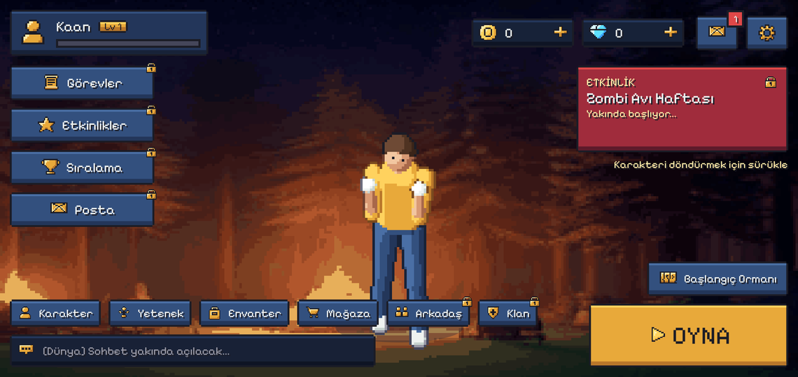
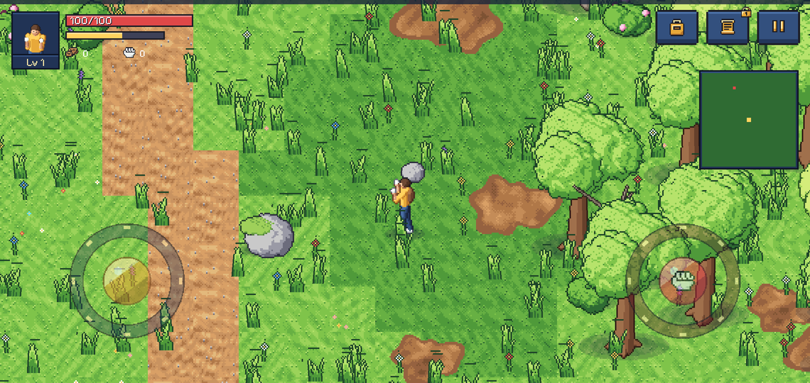

# Zenvex Online — Mühendislik Belgesi

Mobil öncelikli, çevrimiçi 2.5D piksel sanatı zombi hayatta kalma oyunu: malzeme topla, üret, savaş, klana katıl ve
üsleri ele geçir. Oyun çekirdeği Rust, Android uygulaması Kotlin (Jetpack Compose + özel Canvas oyun motoru);
çevrimiçi altyapı Supabase ve isteğe bağlı Rust oyun sunucusu.

Paket: **`com.zenvex.online`** · Dal: `ccr-1288dc35-tplllu` · Her push'ta kurulabilir APK derlenir
(GitHub → **Releases** → "Zenvex Online — son derleme").

Bu belge projenin tek belgesidir: dosya yapısı, derleme, araç zinciri, devir raporu, tasarım, mimari, Supabase,
sunucu, yayın, hukuki uyum, görsel istemleri, test notları, güvenlik ve sürüm geçmişi.

 

---
## İçindekiler

1. Dosya yapısı
2. Derleme, test ve katkı
3. Araç zinciri (Kasım 2026)
4. Devir raporu (yeni oturum için)
5. 00 — Genel Bakış & MVP Kapsamı
6. 01 — Karakter Tasarımı
7. 02 — Arayüz (UI/UX) Tasarımı
8. 03 — Dünya & Oynanış
9. 04 — Teknik Mimari (Rust + Kotlin)
10. Supabase (çevrimiçi altyapı)
11. zx-legal: yasal metin sayfaları
12. Oyun sunucusu
13. Yayın
14. Hukuki uyum
15. Tanıtım Paketi
16. UI/UX ve Oynanış Araştırması (V17) — Bulgular, Karar, Uygulama
17. Görsel istemleri V19
18. Görsel istemleri V20
19. Test notları
20. Güvenlik politikası
21. Sürüm geçmişi

---

## 1. Dosya yapısı

```
Android/                 Android modülü (:Android)
  build.gradle.kts       SDK 37, hedef 37, cargo-ndk ile libzenvex.so, Paparazzi
  proguard-rules.pro     R8 kuralları
  zenvex-dev.jks         ortak geliştirme anahtarı (her sürüm eskisinin üstüne kurulur; mağaza anahtarı gizli)
  Source/Main/
    AndroidManifest.xml
    Kotlin/Core.kt       TÜM uygulama kodu (tek paket com.zenvex.online; bölümler eski dosya adlarıyla işaretli)
    Resources/           Android kaynakları (res)
    Assets/              oyun varlıkları: atlaslar, 3B modeller (m3d), müzik, ses, i18n, arayüz görselleri
  Source/Test/
    Kotlin/Tests.kt      tüm JVM testleri (Paparazzi ekranları, 3B modeller, efekt dokuları, çeviriler)
    Resources/           test verisi (ui/*.json)
    snapshots/images/    Paparazzi referans görüntüleri
Native/                  Rust oyun çekirdeği (crate `zenvex`, libzenvex.so)
  Core.rs                oyun kuralları ve dünya (kök) + 3B çizici (`r3d`) + JNI köprüsü (`bridge`)
  Tests.rs               tüm 3B modellerin yüklenip çizildiği bütünleşik test
  Preview.rs             3B önizleme / simge aracı: cargo run --release --example preview -- <alt komut>
  Cargo.toml · Cargo.lock · rust-toolchain.toml
Server/                  isteğe bağlı WebSocket oyun sunucusu (crate `zenvex_server`)
  Main.rs · Cargo.toml · Cargo.lock · rust-toolchain.toml
  Install.sh · Update.sh · zenvex-server.service   tek komutla kurulum (systemd + Caddy) ve güncelleme
Supabase/
  Migrations/*.sql       veritabanı göçleri (hesaplar, kayıtlar, klanlar, mağaza, destek, yasal uyum)
  Functions/zx-*/        edge fonksiyonları (Google girişi, ödeme doğrulama, destek, yasal sayfalar)
Tools/                   varlık hatları: pixel, assetgen, blender, model3d, i18n (çeviri), promo, ai
Art/                     tanıtım görselleri ve ekran görüntüleri
Gradle/                  Gradle sarmalayıcısı (jar + properties, sağlama toplamı sabit)
build.gradle.kts         kök: eklenti sürümleri + Rust görevleri (nativeLint, nativeTest, nativeBuildHost, server*)
settings.gradle.kts · gradle.properties · gradlew · gradlew.bat
Engineering.md           bu belge
```

## 2. Derleme, test ve katkı

Gerekenler: JDK 25, Android SDK 37 (`platforms;android-37.0`, build-tools 37.0.0), NDK 30.0.16248370, Rust 1.100.0
(`Native/rust-toolchain.toml` kendiliğinden kurar) ve `cargo install cargo-ndk --locked`. Araçlar için Python 3.13+.

```bash
./gradlew check                          # Rust: clippy (uyarı = hata) + testler; çekirdek ve sunucu
CI=true ./gradlew :Android:assembleDebug # APK (Kotlin uyarıları CI'da hata); Rust .so önce cargo-ndk ile derlenir
./gradlew :Android:lintDebug             # Android lint (hata yok)

# Paparazzi (emülatörsüz JVM ekran görüntüleri); oyun kareleri için önce bilgisayar kütüphanesi:
./gradlew nativeBuildHost
./gradlew :Android:verifyPaparazziDebug -x :Android:cargoBuild   # karşılaştır
./gradlew :Android:recordPaparazziDebug -x :Android:cargoBuild   # yeniden kaydet
```

Kurallar:

- Küçük, odaklı değişiklik; testler ve lint yeşil, uyarı yok. Çevredeki kodun adlandırmasına ve yorum yoğunluğuna uy.
- Oyun kuralları `Native/Core.rs` içindedir; Kotlin çizer ve girdiyi iletir. Kuralları Kotlin'de çoğaltma.
- Eşya, altın ya da elmas veren her şey sunucuda (Supabase fonksiyonları) doğrulanır; istemciye güvenilmez.
- Arayüz değişince Paparazzi görüntülerini kaydet ve gözden geçir.

Çeviriler: Türkçe metin çeviri anahtarıdır (9 dil: en es pt ru de fr it id ar). Görünür bir metin ekleyince:

```bash
python3 Tools/i18n/extract.py            # catalog.json'u koddan yeniden kurar, her dilde eksikleri listeler
python3 Tools/i18n/merge.py <dil> dosya  # "<katalog no> <çeviri>" satırları; {0} {1} yer tutucuları korunmalı
```

Bir dilde eksik metin ya da bozuk yer tutucu olursa `I18nTest` başarısız olur. Arayüz piksel yazı tipi kullanır ve
düğmeler dardır: kısa, doğal ifadeler seç.

Commit: emir kipinde konu satırı, gövdede "neden". Her commit tek mantıksal değişiklik.

## 3. Araç zinciri (Kasım 2026)

| Araç | Sürüm | Doğrulama kaynağı |
|---|---|---|
| Gradle | 9.9.1 (sağlama toplamı sabit) | services.gradle.org/versions/current |
| Android Gradle Plugin | 9.5.1 (en az Gradle 9.6) | Google Maven `maven-metadata.xml` |
| Kotlin / Compose derleyici eklentisi | 2.4.21 | Maven Central |
| Compose BOM | 2026.09.00 | Google Maven |
| JDK | 25 (Temurin LTS) | api.adoptium.net |
| Android SDK / build-tools | 37 / 37.0.0 (compileSdk 37, targetSdk 37) | dl.google.com/android/repository/repository2-3.xml |
| NDK | 30.0.16248370 | aynı |
| Rust | 1.100.0, edition 2024 | static.rust-lang.org/dist/channel-rust-stable.toml |
| jni (Rust) | 0.22.4 | crates.io |
| cargo-ndk | 4.1.2 | crates.io |
| Paparazzi | 2.0.0-alpha05.1 (SDK 37 desteği için) | Maven Central |
| bpy (Blender) | 5.3.0 (yalnız Python 3.13) | PyPI |

Kural: sürüm bilgisi her zaman internetten / resmî kayıtlardan doğrulanır; eğitim verisine güvenilmez.

---

## 4. Devir raporu (yeni oturum için)

Hazırlanma: 12 Kasım 2026. Bu belge, projeyi hiç görmemiş yeni bir oturumun kaldığımız yerden sürmesi için yazıldı.
Kullanıcıyla Türkçe konuş. Depo: GitHub `eaquelxonline/Zenvex_Online` (13 Kasım 2026'da zip'ten temiz geçmişle aktarıldı;
eski geçmiş yalnız Drive'daki zip'te). Kullanıcı kuralı: sürüm bilgisi için her zaman internete/kayıtlara bak, eğitim verisine güvenme.

### 1. Proje
- Android (Kotlin, Compose + özel Canvas oyun motoru) + Rust çekirdeği (`Native/Core.rs`, JNI: `zenvex_jni`, 3B: `zenvex_r3d`,
  sunucu: `zenvex_server`) + Supabase (proje `blvstsvmvmdydyrnecpo`: veritabanı, edge fonksiyonları).
- Hayatta kalma / zombi / ortak dünya oyunu. 4 karakter (Kael, Lyra, Vex, Morvath), 3B modeller, bölgeler, tezgâh üretimi,
  kişisel üs, klan, etkinlikler, sezon bileti, mağaza (Google Play), destek bileti, yönetici paneli.
- Ayrıntı: bu belgedeki 00 — Genel Bakış, 04 — Teknik Mimari, Supabase ve Sürüm geçmişi bölümleri (en üst: V22, V21…).

### 2. Kullanıcının değişmez kuralları
- Yönetici kimliği 0; anahtarı yalnız bcrypt özeti olarak tutulur. Google client secret'ı asla kullanma.
- Görsel değişiklikleri doğrula (Paparazzi anlık görüntüleri / ekran testi). Alt ajan (subagent) kullanma (istemedikçe).
- Commit/koda model adı yazma. Commit sonuna şu iki satır: `Co-Authored-By: Claude Opus 5.5 <noreply@anthropic.com>` ve
  `Claude-Session: <oturum bağlantısı>`.
- `Android/save_n1.json` testlerin ürettiği yan dosyadır, `.gitignore`'dadır (commit'lenmez).
- Yasal göç (`20261122_legal_compliance.sql`) ve `zx-legal` fonksiyonu için üretime uygulamadan ÖNCE kullanıcıya sor.
- Üretim veritabanına göç/edge dağıtımı: araç izin vermeyebilir (otomatik mod reddetti); kullanıcıdan izin iste.

### 3. Derleme ve test komutları
- Araç zinciri (V22, 13 Kasım 2026'da kayıtlardan doğrulandı): JDK 25 (Temurin), Gradle 9.9.1, AGP 9.5.1, Kotlin 2.4.21,
  SDK 37 + build-tools 37.0.0, targetSdk 37 (appCategory=game), NDK 30.0.16248370, Rust 1.100 (edition 2024), jni 0.22.4, cargo-ndk 4.1.2.
  Sürüm denetimi: Gradle `services.gradle.org/versions/current`, Google Maven / Maven Central `maven-metadata.xml`,
  `crates.io/api/v1/crates/<ad>`, SDK paketleri `dl.google.com/android/repository/repository2-3.xml`.
- GameShotsTest referans görüntüleri `.gitignore`'da (yalnız 9 tanesi depoda); `verifyPaparazziDebug` bu yüzden GameShotsTest'te
  hep düşer. Doğrulama için HudShotsTest/UiShotsTest/UiArtShotsTest'e bak, oyun karelerini `app/build/game-shots/` altında incele.
- Rust: `cd Native/Core.rs && cargo test` (87 test geçiyor). JNI: `cargo build --release`.
- Android sıkı derleme: `CI=true ./gradlew :Android:compileDebugKotlin -x :Android:cargoBuild` (uyarı = hata). Testler:
  `:Android:compileDebugUnitTestKotlin`; Paparazzi: `GameShotsTest`, `HudShotsTest`, `UiShotsTest`.
- i18n: `python3 Tools/i18n/extract.py` (hedef: tüm dillerde 0 eksik; 9 dil: en es pt ru de fr it id ar). Eksikleri çevirip
  `Android/Source/Main/Assets/i18n/<dil>.json` içine ekle (yer tutucular `{0}` korunmalı). Şu an 0 eksik.
- Yerel Postgres (SQL denemeleri için) gerekirse `/tmp/pgzx` altında yeniden başlatılır.
- Görsel üretim istemleri: bu belgedeki Görsel istemleri V19 ve V20 bölümleri; gelen görseller `assets/ui/<ad>.png` olarak
  konunca kod değişmeden kullanılır (`btn_skills`, `btn_chars`, `btn_crate`, `btn_shop`, `skill_<istatistik>`).

### 4. V22 (13 Kasım 2026): araç zinciri yenileme — ayrıntı Engineering.md › Sürüm geçmişi'da. Dal: `ccr-1288dc35-tplllu`.

### 4b. Önceki oturum (V21; yerel commit'ler, eski geçmişte)
Commit sırası (eskiden yeniye): 11c94bc (M1+M2) → cabdde1 (M3 araçlar) → a273200 (M4 destek/yönetici) → e524c5f (M5 karakter kimlikleri,
görsel kancaları, V20 prompt belgesi) → 0b2ef50 (V21). Depo bu zip'te; `git log` ile görülür. İtme: yeni bir GitHub deposu açılırsa
`git remote set-url origin <yeni>` ve `git push -u origin <dal>` (dal: `ccr-f72bf0e8-k8itdv`).

V21 (kullanıcının 17 maddelik listesi) — hepsi kodlandı:
1. Üretim ekranı malzeme değişimini 0,7 sn'de bir yeniler (`Screens.kt` CraftScreen `qtick`) → çık-gir gerekmez.
2. El üretimi ve tezgâh aynı tarif listesini gösterir (`ui.rs` craft/craft_bench filtresi kalktı; tezgâh tarifi elde "tezgâh gerekli").
3. Tezgâha Uzi, AK-47, Keskin Nişancı, RPG-7 tarifleri eklendi (`data.rs` RECIPES). Etkinlik silahları hariç tüm silahlar yapılabilir
   (Polis Copu ve M4 oyundan kaldırılmış durumda, RETIRED_ITEMS).
4. Etkinlik ödül afiş sayfası (`PosterView`) ve 18 `art_ev_*.webp` silindi. (`Tools/pixel/event_import.py` hâlâ posters() içerir; ölü kod.)
5. Harita bulutları zamanla kaymıyor, haritaya sabit (`WorldMap.kt` drawClouds).
6/15. Eski gizemli ağaç: rastgele orman ağaçlarından `oak_autumn` çıkarıldı (RNG sırası korunarak `oak1`). Yeni gizemli ağaç
   `LANDMARKS "tree"` (232,262 karo) konumunda Deco olarak durur. Kullanıcı "X184 Y243" gördüğünü söyledi; bu `oak_autumn` olabilir —
   yeni sürümde hâlâ görülürse o koordinatın statiğini incele (`world.rs` push → sprite adı).
7. Motor simgesi artık gerçek Nightstalker modelinin karartılmışı (`VehicleUi.kt` MotoIcon).
8. Rehber görev yazısı sol üstte (`Tutorial.kt` GuideBubble), süresiz kalır (`GameView.kt` tutAlpha).
9. Profil: fotoğraf varken karakter resmi seçmek artık fotoğrafın yerine geçer (Kaydet'te fotoğraf silinir); varsayılan resim oyundaki
   karakterin portresi (eskiden Marco çıkıyordu). NOT: oyun içi sol üst portre hâlâ seçilen karakteri gösterir; kullanıcı NPC
   resmi seçtiyse oyun içinde yine karakter portresi görünür (istenirse HUD'a ProfileAvatar bindirilebilir).
10. Yerdeki tüm sandıklar (`Kind::Crate`, `chest_*`) çimene dönüştü (`world.rs` push başı). Depo sandıkları yalnız kişisel üste.
11. Rehber "İlk Silah": Bıçak yerine Sopa (`w_bat`; `story.rs` g4f/g4g, `Bag.kt`, `GameView.kt` metinleri, `training.rs` testi).
12. Haritada NPC'nin 10 karo yakınındaki yer imi çizilmez (`WorldMap.kt` mapMarks).
13. Arka planda 30 sn sayaç (`Session.kt` BG_LIMIT_MS, `bgKick`); süre dolmadan dönülürse oyun kesintisiz sürer.
14. Kopma sonrası girişte kampa ışınlanma (`Session.takeLost` → `GameSession.cmd("to_camp")`, `ui.rs` "to_camp").
16. Zombi yakınken ağaç/kaya vuruşu engeli kaldırıldı (`combat.rs`).
17. Yönetici etkinlik sıralamasından çıkarıldı: `Supabase/Migrations/20261124_v21_fixes.sql` (ÜRETİME UYGULANMADI, aşağıya bak).
18. (Kullanıcı boş bıraktı.)

M5 (karakter kimlikleri): `data.rs` CHAR_BASE (Kael hız/kaçınma, Lyra kritik/hız az can, Vex tank, Morvath hasar/can çalma) +
`char_stats()`; `rpg.rs` bonus uygular; `progress.rs` max_hp hp_pct ile; `Characters.kt` değerleri gösterir.

### 5. Üretim (Supabase) durumu
- Uygulandı: göçler V20'ye kadar, `v20_fixes` (zx_photos, set_level/set_char_level, zx_save3 admin_level izni, zx_admin_support photos);
  edge `zx-support` v2 (id 0 düzeltmesi) dağıtıldı.
- BEKLEYEN (hiçbiri uygulanmadı):
  - `20261124_v21_fixes.sql` (yönetici etkinlik sıralaması) — kullanıcı onayıyla uygula.
  - `20261122_legal_compliance.sql` + `zx-legal` edge fonksiyonu — kullanıcıya sormadan uygulama (kural).
  - `20261120_trade_expect.sql`.
  - `zx-billing` edge düzeltmesi (`id == null`) dağıtılmadı.
- Yayın öncesi (kodla çözülmeyen): `Engineering.md › Hukuki uyum` baştaki 7 madde (künye, KVKK m.9 bildirimi, VERBİS/ETBİS, Play Veri Güvenliği…).

### 6. Bilinen eksikler / sonraki adımlar
1. Doğrulanmadı: bu oturumun son değişiklikleri (profil seçimi, bağlantı sayacı, rehber balonu, motor simgesi) için Paparazzi
   anlık görüntüsü ya da cihaz denemesi yapılmadı; yalnız derleme + Rust testleri geçti. Yeni oturumda GameShotsTest/HudShotsTest/
   UiShotsTest çalıştırıp görsel kontrol et (özellikle motor simgesi ve sol üst rehber balonunun HUD ile çakışmaması).
2. Kullanıcı görselleri Görsel istemleri V20 bölümünden üretip getirirse `assets/ui/` altına koy (kod hazır).
3. Üretim göçlerini kullanıcı onayıyla uygula (yukarıdaki liste).
4. GitHub: depo bağlı (`eaquelxonline/Zenvex_Online`); açık PR yok.
5. Rehber tutorial'ı el üretiminde tezgâh tarifleri görünür olduğundan `Tut.craftWant()`/`wrongPlace` mantığını bir kez gözden geçir.

### 7. Dosya haritası (en çok dokunulanlar)
V22'den beri tüm Kotlin `Android/Source/Main/Kotlin/Core.kt`, tüm Rust `Native/Core.rs` içindedir; aşağıdaki eski dosya
adları bu dosyalarda bölüm başlığıdır (Kotlin: `// ui/Bag.kt` satırı; Rust: `mod data {` gibi modül blokları).
- Rust: `data.rs` (eşya, tarif, karakter, görev tanımları), `ui.rs` (arayüz JSON'ları + komutlar), `world.rs` (dünya üretimi),
  `story.rs` (rehber ve ana görevler), `combat.rs`, `vehicles.rs`, `progress.rs`, `rpg.rs`, `game.rs`.
- Kotlin: `ui/Bag.kt`, `ui/Screens.kt` (üretim, tüccar), `ui/WorldMap.kt`, `ui/WizardMap.kt`, `ui/Profile.kt`, `ui/Tutorial.kt`,
  `ui/VehicleUi.kt`, `ui/Characters.kt`, `ui/TreeScreen.kt`, `ui/EventScreen.kt`, `game/Session.kt`, `game/GameView.kt` (HUD, çizim),
  `game/RegionMap.kt`, `game/Model3D.kt`, `net/*`.
- Sunucu: `Supabase/Migrations/*.sql`, `Supabase/Functions/*` (zx-support, zx-billing, zx-legal…).

---

## 5. 00 — Genel Bakış & MVP Kapsamı

### 1. Vizyon (tek cümle)
Telefonda iki joystickle oynanan, sıcak renkli 2.5D pixel art bir dünyada zombileri yumruklayarak level kasılan, ileride online hayatta kalma MMO'suna dönüşecek bir oyun.

### 2. Görsel Kimlik
- **Kamera:** Üstten 3/4 (oblique / "top-down 2.5D"). İzometrik DEĞİL — dünya kare ızgara, nesneler önden-yukarıdan görünür (Stardew Valley / Zombix Online / Graveyard Keeper açısı).
- **Derinlik hissi:** Y-sıralama (aşağıdaki nesne öne çizilir), gölge sprite'ları, ağaç gövdesinin arkasına geçince tepenin yarı saydam olması, hafif paralaks bulut gölgeleri.
- **Pixel ölçeği:** 1 karo = 32×32 px. Sanal çözünürlük yüksekliği **360 px** (genişlik ekran oranına göre 640–800). Tamsayı ölçekleme (3×, 4×) + nearest-neighbor → bulanıklık yok.
- **Palet:** Sınırlı 48 renklik özel palet (bkz. 01_KARAKTER.md §5). Tüm görseller bu palete indirgenir.
- **Ton:** "Sevimli ama tehlikeli" — doygun yeşiller, sıcak gün ışığı, zombiler soluk yeşil-mor, kan yerine koyu kırmızı pixel parçacık (yaş sınırı için ayarlanabilir).

### 3. MVP (İlk Sürüm) — VAR
| Alan | İçerik |
|------|--------|
| Karakter | 1 adet hazır karakter ("Kaan" — bkz. 01), 4 yön + ayna, tam animasyon seti |
| Dünya | Tek düz harita (örn. 128×128 karo), çim/toprak/patika zemin, ağaçlar, çalılar, çiçekler, otlar, taşlar, rüzgârda sallanma |
| Düşman | 1 tip zombi (Yürüyen), basit yapay zeka: dolaş → gör → kovala → vur |
| Savaş | Sadece yumruk (3'lü kombo), zombiye hasar, geri itme, ölüm |
| Toplama | Ağaca yumruk → odun (envanter sadece sayaç) |
| İlerleme | XP, Level (1–50), skill puanı, 4 skill (bkz. 03) |
| Kontrol | Sol: Hareket joysticki · Sağ: Saldırı joysticki (yönlü vuruş) |
| Arayüz | Tüm lobi ekranları ve tuşları **tasarlanmış ve yerinde**; çoğu "Yakında" uyarısı verir |
| Ayarlar | Grafik, hassasiyet, kontroller (HUD düzenleyici), ses, dil — çalışır |
| Kayıt | Yerel kayıt (cihazda). Online yok. |

### 4. MVP — YOK (ama tuşu var)
Online/çok oyunculu, sohbet, klan, arkadaşlar, mağaza/ödeme, silahlar, inşa, craft, açlık/susuzluk, gece-gündüz (opsiyonel), araç, görevler, etkinlikler, posta, sıralama.

### 5. Yol Haritası (öneri)
| Aşama | Hedef | Çıktı |
|-------|-------|-------|
| F0 | Planlama & tasarım | Bu belgeler, görsel promptları, palet, UI wireframe |
| F1 | Görsel üretim | Konsept → sprite sheet → tileset → UI kit |
| F2 | Rust prototip (PC) | Hareket, kamera, y-sort, ağaçlar, rüzgâr |
| F3 | Savaş & zombi | Yumruk kombo, hitbox, zombi AI, XP |
| F4 | Android kabuğu | Kotlin + Compose lobi, JNI, joystickler, ayarlar |
| F5 | Level/Skill + kayıt | Skill ağacı, kayıt/yükleme, ses |
| F6 | Cila & test | Performans (düşük cihaz 60 FPS), kapalı test APK |
| F7+ | Online | Rust sunucu, hesap, çok oyunculu |

### 6. Başarı Ölçütleri (MVP)
- 3 GB RAM'li orta-alt Android'de **sabit 60 FPS**, ilk açılış < 5 sn.
- Dokunmadan karaktere hareket gecikmesi < 50 ms.
- APK < 80 MB.
- Yeni oyuncu 2 dakika içinde ilk zombiyi kesip level atlamalı.

---

## 6. 01 — Karakter Tasarımı

> **Güncelleme (07):** Karakter **gerçekçi oranlı**, **8 yönlü**, kare boyutu **96×80** (ayak noktası 48,66).
> Görseller kodla üretiliyor (`Tools/assetgen/character.py`). Aşağıdaki tablolarda 4 yön / 48×48 / yarı-chibi
> geçen yerler bu kararla değişti; uygulanan animasyon listesi 07 §3'te.

### 1. İlk Karakter: "Kaan" (çalışma adı — değiştirilebilir)
| Özellik | Değer |
|---------|-------|
| Rol | Sıradan bir hayatta kalan; salgından sonra ormanda uyanan genç adam |
| Yaş görünümü | 20'ler |
| Siluet | Sade, okunur: büyük kafa/beden oranı ~1:2.5 (chibi'ye yakın ama çocuksu değil) |
| Saç | Kısa, dağınık, koyu kahve; alnına düşen tutam (pixelde tanınma işareti) |
| Üst | Hardal sarısı kapüşonlu sweatshirt, kollar dirseğe kadar sıvalı |
| Alt | Koyu lacivert kot, dizde yırtık |
| Ayakkabı | Kirli beyaz spor ayakkabı |
| Aksesuar | Ellerde bez sargı (yumruk dövüşçüsü olduğunu anlatır), sırtta küçük kahverengi sırt çantası |
| Renk okunurluğu | Hardal üst → yeşil zeminde ve yeşilimsi zombiler arasında anında seçilir |

> Neden böyle? Mobil ekranda karakter ~90–130 px yüksekliğinde görünecek. Tek baskın renk (hardal) + koyu alt + açık ayakkabı = 3 net blok → her arka planda okunur.

### 2. Teknik Ölçüler
| Öğe | Değer |
|-----|-------|
| Kare (frame) boyutu | **48×48 px** |
| Karakterin görünür boyu | ~38 px (≈1.2 karo) |
| Pivot / ayak noktası | (24, 44) — y-sıralama ve gölge buna göre |
| Gölge | Ayrı sprite, 20×8 px yarı saydam elips |
| Yönler | 4 yön çizilir: **Aşağı, Yukarı, Yan (sağ)**, Sol = Sağ'ın aynası → 3 çizim seti. (İleride 8 yön opsiyonu, bkz. Sorular) |
| Çizgi (outline) | 1 px, renkli koyu outline (saf siyah değil, #1b1c26) |
| Işık yönü | Sol-üstten |
| Kare hızı | Animasyon başına 8–12 FPS (oyun 60 FPS) |

### 3. Animasyon Listesi (her biri × 3 yön)
| # | Animasyon | Kare | FPS | Döngü | Not |
|---|-----------|------|-----|-------|-----|
| 1 | Idle (bekleme, nefes) | 4 | 6 | ✔ | Omuz hafif iner-kalkar, göz kırpma 1/4 olasılık |
| 2 | Walk (yürüme) | 6 | 10 | ✔ | Joystick %0–60 |
| 3 | Run (koşma) | 6 | 12 | ✔ | Joystick %60–100, toz parçacığı |
| 4 | Punch A (sol yumruk) | 4 | 14 | ✘ | Kombo 1 |
| 5 | Punch B (sağ yumruk) | 4 | 14 | ✘ | Kombo 2 |
| 6 | Punch C (güçlü aparkat) | 6 | 12 | ✘ | Kombo 3, ekran sarsıntısı |
| 7 | Chop (ağaca vuruş) | 5 | 12 | ✘ | Punch C'nin yatay varyantı, talaş parçacığı |
| 8 | Hurt (hasar alma) | 2 | 10 | ✘ | Beyaz flaş 1 kare |
| 9 | Death (ölüm) | 6 | 8 | ✘ | Son kare yerde kalır |
| 10 | Level Up | 6 | 10 | ✘ | Yumruk havaya, ışık sütunu efekti ayrı |
| 11 | Spawn / uyanma | 6 | 8 | ✘ | Lobi → oyuna geçişte |
| 12 | Lobi pozu (idle_lobby) | 8 | 6 | ✔ | Lobide büyük önizleme için, sadece Aşağı yön |

Toplam ≈ 63 kare × 3 yön ≈ **190 kare**. Sprite sheet: her satır bir animasyon, her sütun bir kare (bkz. 05 promptları).

#### Animasyon Durum Makinesi
```
Idle ⇄ Walk ⇄ Run
  │  (saldırı joysticki)
  ▼
Punch A → (0.35 sn içinde tekrar) → Punch B → Punch C → Idle
  │ hedef ağaç ise → Chop
Herhangi → Hurt → önceki
Herhangi → Death (HP=0)
```
- Hareket ederken yumruk: alt gövde yürümeye devam etmez; MVP'de yumruk anında %40 yavaşlama (basit, tek sprite seti).

### 4. Lobi İçin Ek Görseller
- Büyük karakter portresi (HUD sol üst, 64×64 px pixel)
- Lobi önizleme (idle_lobby, 3× ölçekli gösterim)
- Kart illüstrasyonu (karakter seçim ekranı, yüksek çözünürlüklü pixel art 256×384)

### 5. Ana Palet (taslak — 48 renk)
| Grup | Renkler (hex) |
|------|---------------|
| Outline / gölge | #1b1c26 #2b2d3c #3e4157 |
| Ten | #f2c6a0 #d99a74 #a8684a #6e3f2e |
| Hardal | #ffd25e #e8a93a #b9772a #7a4a1f |
| Lacivert | #4a6fa5 #33507e #23365a #172238 |
| Çim / bitki | #b6e36b #7fc44a #4f9a3a #2f6b33 #1d4428 |
| Toprak | #d9a066 #b07848 #7d5233 #4f3322 |
| Ağaç gövde | #8a5a3c #66402b #45291d |
| Taş | #c9c9c9 #9a9aa6 #6c6c7c #45465a |
| Zombi ten | #a7c48a #7f9f6a #5a7650 #3c5040 |
| Zombi kıyafet | #8a6fa0 #5f4a78 #3d2f52 |
| Kan / hasar | #e04848 #a02c3c #5e1a2a |
| UI vurgu | #ffe9a8 #5ee0ff #3aa0ff #ff7a3a |
| Beyaz/açık | #ffffff #eef2f0 #c7d3cf |

> Promptlar ile üretilen her görsel bu palete **quantize** edilecek (Aseprite / Pyxel Edit / "Palette Swap" scripti).

---

## 7. 02 — Arayüz (UI/UX) Tasarımı

> **Güncelleme (07):** Oyun içinde sadece **2 joystick** var: hareket (sol) ve **saldırı (sağ)**. Saldırı joysticki
> çevrildiği yöne yumruk attırır, basılı tuttukça seri devam eder; otomatik nişan ve skill/eşya/etkileşim tuşları
> kaldırıldı.

Kural: **Her tuş yerinde olacak.** Çalışmayan tuşlar gri değil, normal görünür; basınca "🔒 Yakında!" tostu (1.5 sn) çıkar. Böylece oyun "eksik" değil "büyüyen" hissi verir.

### 0. Genel UI Kuralları
| Konu | Karar |
|------|-------|
| Yön | **Yatay (landscape)** kilitli |
| Stil | Pixel art UI: 9-slice paneller, 2 px koyu outline, üst kenarda 1 px açık vurgu, alt kenarda 2 px gölge (bastırılmış "tuş" hissi) |
| Ana renkler | Panel: koyu lacivert #23365a (%92 opak) · Birincil tuş: hardal #e8a93a · İkincil: #33507e · Tehlike: #a02c3c · Kilitli/yakında: üzerinde küçük kilit rozeti |
| Font | Pixel font (öneri: "Pixelify Sans" / "Press Start 2P" başlık, "m5x7"/"Silkscreen" gövde). **Türkçe karakterler (ğ ş ı İ ö ü ç) zorunlu** |
| Dokunma alanı | Min. 48×48 dp, tuşlar arası ≥ 8 dp |
| Güvenli alan | Çentik / kamera deliği için `WindowInsets` boşluğu |
| Basma geri bildirimi | Tuş 2 px aşağı iner + kısa "tık" sesi + hafif titreşim (ayarlardan kapatılabilir) |
| Geçişler | 150–250 ms; ekran geçişinde pixel "dissolve" (dither) efekti |
| Dil | Türkçe (varsayılan) + İngilizce. Tüm metinler `strings.xml` / Rust tarafında `.ftl` (Fluent) |

### 1. Ekran Akışı
```
Splash (logo) → Yükleme/Güncelleme → Giriş Ekranı → [İlk kez ise] Karakter Tanıtım/İsim
      → ANA LOBİ ──┬─ OYNA → Sunucu/Dünya Seç → Yükleme Ekranı → OYUN (HUD)
                   ├─ Karakter
                   ├─ Yetenekler (Skill)
                   ├─ Envanter
                   ├─ Mağaza 🔒
                   ├─ Arkadaşlar 🔒 · Klan 🔒 · Sohbet 🔒
                   ├─ Görevler 🔒 · Etkinlikler 🔒 · Posta 🔒 · Sıralama 🔒
                   ├─ Ayarlar
                   └─ Profil
OYUN → Duraklat Menüsü → (Devam / Ayarlar / Lobiye Dön)
OYUN → Ölüm Ekranı → (Yeniden Doğ / Lobiye Dön)
```

### 2. Splash & Giriş
**Splash:** Siyah → pixel logo "ZENVEX ONLINE" düşer + sallanır, altında stüdyo adı. 2 sn.

**Giriş ekranı** (arka plan: hareketli pixel orman, zombiler uzakta yürür):
| Öğe | Konum | Durum |
|-----|-------|-------|
| Logo | Üst orta | — |
| [Misafir Olarak Oyna] | Orta, büyük, hardal | ✔ çalışır |
| [Google ile Giriş] | Altında | 🔒 |
| [Hesap Oluştur / E-posta] | Altında | 🔒 |
| Dil seç (🌐 TR/EN) | Sağ üst | ✔ |
| Sürüm no. | Sol alt, küçük | ✔ |
| Kullanım Şartları · Gizlilik | Alt orta, link | ✔ (metin sayfası) |
| "Ekrana dokun" yanıp sönen yazı | (Misafir hesabı varsa direkt) | ✔ |

### 3. ANA LOBİ (en önemli ekran)
```
┌──────────────────────────────────────────────────────────────────────────┐
│ [Avatar][Kaan  Lv 7 ███░░ XP]     [🪙 1.250 +] [💎 30 +] [⚡ 5/5]  [✉][⚙] │
│                                                                          │
│ ┌────────┐                                                ┌────────────┐ │
│ │Görevler│                                                │ Etkinlik   │ │
│ │Etkinlik│          ( KARAKTER BÜYÜK ÖNİZLEME )           │ banner 🔒  │ │
│ │Sıralama│          idle_lobby animasyonu, yerde          └────────────┘ │
│ │Posta   │          ateş/kamp, arkada orman paralaks                     │
│ └────────┘          [⟲ karakteri döndür sürükle]                         │
│                                                                          │
│ [Karakter][Yetenek][Envanter][Mağaza][Arkadaş][Klan]   [ Sunucu: TR-1 ▾] │
│                                                      ┌────────────────┐  │
│ [💬 Sohbet satırı (kapalı) .....................]    │    ▶ OYNA      │  │
│                                                      └────────────────┘  │
└──────────────────────────────────────────────────────────────────────────┘
```
| Bölge | Öğeler | Durum |
|-------|--------|-------|
| Üst sol | Avatar (profil), isim, level rozeti, XP barı | ✔ |
| Üst orta-sağ | Altın 🪙 (+), Elmas 💎 (+), Enerji ⚡ (görsel) | Sayı ✔, (+) 🔒 |
| Üst sağ | Posta ✉ (kırmızı nokta), Ayarlar ⚙ | ✉ 🔒, ⚙ ✔ |
| Sol dikey menü | Görevler, Etkinlikler, Sıralama, Posta | 🔒 |
| Orta | Karakter önizleme, kamp ateşi, sürükle → döndür (4 yön) | ✔ |
| Sağ üst | Etkinlik banner'ı (kaydırmalı) | 🔒 |
| Alt şerit | Karakter, Yetenek, Envanter, Mağaza, Arkadaş, Klan | Karakter/Yetenek/Envanter ✔, diğerleri 🔒 |
| Alt sağ | **OYNA** (büyük, nabız gibi atan parlama), Sunucu seçici | OYNA ✔, sunucu sadece "Tek Oyunculu" |
| Alt sol | Sohbet satırı | 🔒 |
| Arka plan | Gece-akşam ormanı, ateş ışığı titreşimi, ateşböcekleri | ✔ |

### 4. Alt Ekranlar
#### 4.1 Karakter
Sol: büyük önizleme (döndürülebilir). Sağ: istatistik paneli — Level, HP, Dayanıklılık, Saldırı, Hız, Kritik, Toplam Öldürme, Kesilen Ağaç, Oynama Süresi. Alt: [Kıyafet 🔒] [Görünüm 🔒] [İsim Değiştir 🔒] sekmeleri. Ekipman slotları (Kafa, Gövde, Bacak, Ayak, Eldiven, Çanta) — boş çerçeve, dokununca 🔒.

#### 4.2 Yetenekler (Skill)
- Üstte "Skill Puanı: 3" + [Sıfırla 🔒]
- 4 sütunlu ağaç (bkz. 03 §6): her düğüm 48×48 ikon, altında seviye `2/10`, dokununca açıklama paneli + [Yükselt] tuşu.
- Kilitli düğümler koyu + zincir ikon, gereken level yazılı.

#### 4.3 Envanter
6×5 ızgara slot (MVP: sadece Odun, Taş?, Zombi Dişi gibi düşen eşyalar sayaç olarak). Sağda seçili eşya detayı. Tuşlar: [Kullan 🔒] [At 🔒] [Sırala ✔]. Üst sekmeler: Tümü / Malzeme / Ekipman 🔒 / Tüketilebilir 🔒.

#### 4.4 Mağaza 🔒
Tasarımı yapılır, ekran açılır ama "Yakında" katmanı ile: sekmeler Öne Çıkan / Kostüm / Elmas / Paketler.

#### 4.5 Profil
Avatar, isim, ID (kopyala), oyun istatistikleri, rozetler (boş), [Çıkış Yap].

#### 4.6 Sunucu / Dünya Seçimi
Kart listesi: "🌲 Başlangıç Ormanı (Tek Oyunculu) ✔", "TR-1 Online 🔒", "EU-1 🔒". Her kartta ping (—), oyuncu sayısı (—), zorluk.

#### 4.7 Yükleme Ekranı
Tam ekran illüstrasyon (05 §UI-12), alt bar pixel ilerleme çubuğu (zombi eli sürünüyor), rastgele ipucu metni ("Ağaçlara yumruk atarak odun toplayabilirsin!").

### 5. OYUN İÇİ HUD
```
┌──────────────────────────────────────────────────────────────────────────┐
│[Portre] ❤ HP ██████████ 100/100            [🗺 Mini-harita]   [⏸]       │
│ Lv 7    ⚡ Dayanıklılık ████████            (yuvarlak, 96dp)  [🎒][📋🔒] │
│ XP ████░░░░░░  (ince, ekran üst kenarı boyunca da olabilir)              │
│                                                                          │
│                        ( OYUN DÜNYASI )                                  │
│                                                       [🔄🔒][🍖🔒]        │
│                                                       [⚔ Skill1🔒]       │
│   ╭───────╮                                       [Skill2🔒] ╭───────╮   │
│   │   ●   │  HAREKET                              SALDIRI    │  👊   │   │
│   ╰───────╯  joysticki                            joysticki  ╰───────╯   │
│                          [Etkileşim / Topla ✋] (bağlamsal)               │
└──────────────────────────────────────────────────────────────────────────┘
```

#### 5.1 Hareket Joysticki (sol)
| Özellik | Değer |
|---------|-------|
| Tür | **Dinamik** (varsayılan): sol yarı ekranda nereye dokunulursa orada belirir. Ayardan "Sabit" seçilebilir |
| Boyut | Taban 140 dp, topuz 60 dp (ayardan %70–150) |
| Ölü bölge | %12 (ayar 0–30) |
| Yürüme/Koşma eşiği | %60 (ayar) |
| Görsel | Pixel halka, bastığında hafif parlar; topuz 8 yönlü ok izi |
| Boşta | %40 opak, kullanımda %90 |

#### 5.2 Saldırı Joysticki (sağ)
| Özellik | Değer |
|---------|-------|
| Davranış | **Dokun = en yakın hedefe otomatik yönelip vur** (aim-assist), **sürükle = o yöne vur** (yönlü), basılı tut = otomatik kombo |
| Boyut | Taban 120 dp, ortada yumruk ikonu |
| Yön göstergesi | Sürüklerken karakterin önünde yarı saydam yay (vuruş alanı) gösterilir |
| Bekleme | Kombo sonunda kısa cooldown, halka dolum animasyonu |
| Ayarlar | Otomatik nişan aç/kapa, nişan gücü, yay göstergesi aç/kapa |

#### 5.3 Diğer HUD Öğeleri
| Öğe | Durum |
|-----|-------|
| Portre + HP + Dayanıklılık (stamina — koşu/yumruk harcar) + XP | ✔ |
| Mini-harita (dokununca büyük harita 🔒 veya ✔ basit) | ✔ basit |
| Duraklat ⏸ | ✔ |
| Çanta 🎒 (envanter overlay) | ✔ |
| Görev listesi 📋 | 🔒 |
| Etkileşim ✋ (ağaç/eşya yakınında belirir) | ✔ (opsiyonel; yumruk da yeter) |
| Skill 1–2 slotları, eşya hızlı slotu, yemek 🍖, silah değiştir 🔄 | 🔒 (yerleri hazır) |
| Hasar sayıları (beyaz, kritik sarı büyük) | ✔ |
| Zombi üstü HP barı (vurulunca 3 sn görünür) | ✔ |
| Level Up efekti + "SEVİYE 8!" banner + skill puanı bildirimi | ✔ |
| Toplama bildirimi (sol orta: "+3 Odun") | ✔ |
| Düşük HP'de ekran kenarı kırmızı nabız | ✔ |
| FPS / ping göstergesi (ayarlardan) | ✔ |

#### 5.4 Duraklat Menüsü
Bulanık/dither karartma + panel: [Devam Et] [Ayarlar] [Kontrolleri Düzenle] [Lobiye Dön] (onay penceresi).

#### 5.5 Ölüm Ekranı
Ekran gri-kırmızıya döner, "ÖLDÜN" pixel yazı, istatistik (yaşama süresi, öldürme), [Yeniden Doğ (5 sn)] [Lobiye Dön]. MVP cezası: XP kaybı yok (veya %5 — bkz. sorular).

### 6. AYARLAR (tam liste — hepsi çalışacak)
Sekmeli panel: **Grafik · Kontrol · Ses · Oyun · Hesap · Hakkında**

#### 6.1 Grafik
| Ayar | Seçenekler | Varsayılan |
|------|-----------|-----------|
| Hazır ayar | Düşük / Orta / Yüksek / Ultra / Özel | Cihaza göre otomatik |
| FPS limiti | 30 / 45 / 60 / 90 / 120 (cihaz destekliyorsa) | 60 |
| Render ölçeği | %50 / %75 / %100 (piksel çözünürlüğü değil, son çıktı) | %100 |
| Pixel ölçekleme | Tamsayı (keskin) / Ekrana doldur (hafif bulanık) | Tamsayı |
| Bitki yoğunluğu | Düşük (%30) / Orta (%60) / Yüksek (%100) | Orta |
| Rüzgâr animasyonu (ağaç/ot sallanma) | Kapalı / Basit / Tam (shader) | Tam |
| Gölgeler | Kapalı / Blob (elips) / Yönlü sprite gölge | Blob |
| Parçacık efektleri | Kapalı / Az / Çok | Çok |
| Işıklandırma (ateş, ışık sütunu, bloom) | Kapalı / Açık | Açık |
| Bulut gölgeleri | Kapalı / Açık | Açık |
| Görüş mesafesi (aktif nesne yarıçapı) | Yakın / Orta / Uzak | Orta |
| Ağaç arkası saydamlık | Açık / Kapalı | Açık |
| Ekran sarsıntısı | 0–100% | 70% |
| Hasar sayıları | Açık / Kapalı | Açık |
| Pil tasarrufu modu | Açık (30 FPS + düşük efekt) / Kapalı | Kapalı |
| FPS göstergesi | Açık / Kapalı | Kapalı |

#### 6.2 Kontrol & Hassasiyet
| Ayar | Seçenekler | Varsayılan |
|------|-----------|-----------|
| Hareket joysticki türü | Dinamik / Sabit | Dinamik |
| Hareket hassasiyeti | 0.5× – 2.0× (kaydırıcı) | 1.0× |
| Hareket ölü bölge | %0 – %30 | %12 |
| Koşma eşiği | %40 – %90 | %60 |
| Saldırı joysticki hassasiyeti | 0.5× – 2.0× | 1.0× |
| Saldırı ölü bölge | %0 – %30 | %15 |
| Otomatik nişan | Kapalı / Zayıf / Güçlü | Zayıf |
| Vuruş yayı göstergesi | Açık / Kapalı | Açık |
| Basılı tutunca otomatik saldırı | Açık / Kapalı | Açık |
| Joystick boyutu | %70 – %150 | %100 |
| Joystick saydamlığı | %20 – %100 | %60 |
| Titreşim (haptik) | Kapalı / Hafif / Güçlü | Hafif |
| Sol el modu (joystickleri değiştir) | Açık / Kapalı | Kapalı |
| **HUD Düzenleyici** → [Düzenle] | Her HUD öğesini sürükle, boyutlandır, saydamlık; [Sıfırla] [Kaydet]; 3 profil slotu | — |
| Gamepad desteği | (bilgi) Bluetooth gamepad algılandı/algılanmadı | Otomatik |

#### 6.3 Ses
Ana ses, Müzik, Efektler, Ortam (rüzgâr/kuş), Arayüz sesleri, Zombi sesleri — her biri 0–100 kaydırıcı. [Arka planda sesi kapat] aç/kapa.

#### 6.4 Oyun
Dil (TR/EN), Hasar sayısı stili, Bildirimler 🔒, Kamera yakınlaştırma (Yakın/Normal/Uzak = 3×/2.5×/2× ölçek), Kamera yumuşatma, Renk körlüğü modu (Deuteranopi/Protanopi/Tritanopi filtre), Yazı boyutu.

#### 6.5 Hesap
Misafir ID, [Hesabı Bağla 🔒], [Bulut Kayıt 🔒], [Verileri Sil] (çift onay), [Çıkış].

#### 6.6 Hakkında
Sürüm, yapımcılar, lisanslar (Rust crate'leri, fontlar), [Destek/Geri Bildirim 🔒], Gizlilik.

### 7. UI Bileşen Kiti (çizilecek görseller listesi)
Panel 9-slice (koyu, açık, uyarı), tuş 9-slice (birincil/ikincil/tehlike × normal/basılı/kilitli), sekme, kaydırıcı (ray + topuz), aç/kapa anahtarı, onay kutusu, açılır menü, ilerleme barları (HP kırmızı, stamina sarı, XP mavi-camgöbeği), slot çerçeveleri (normal/seçili/nadirlik renkleri), joystick tabanı + topuz, yumruk ikonu, para ikonları, ~40 menü ikonu, kilit rozeti, kırmızı bildirim noktası, tost kutusu, onay penceresi, tooltip. Ayrıntılı promptlar → 05.

---

## 8. 03 — Dünya & Oynanış

### 1. Dünya: "Başlangıç Ormanı"
| Özellik | Değer |
|---------|-------|
| Boyut | 128×128 karo (4096×4096 px) — ileride chunk'lı sonsuz/büyük harita |
| Zemin | Düz, yükselti yok. Katmanlar: Çim (ana), Koyu çim lekeleri, Toprak patika, Çıplak toprak, Küçük gölet (geçilmez su — opsiyonel) |
| Kenar | Harita kenarında aşılmaz sık orman duvarı |
| Doğuş noktası | Haritanın ortasında küçük açıklık + sönmüş kamp ateşi + devrilmiş kütük |
| Üretim | Prosedürel (seed ile): Poisson-disk dağıtım + gürültü (noise) maskesi → orman yoğun bölgeler, açıklıklar, çiçek tarlaları |
| Kamera | Karaktere yumuşak takip (lerp), ölü bölge küçük, kenarda durma |
| Zaman | MVP: sabit "öğleden sonra" ışığı. (Gece-gündüz soru listesinde) |

#### 1.1 Zemin Tileset (32×32)
- Çim düz ×4 varyant, çim + çiçek ×4, koyu çim ×2
- Toprak ×3, patika ×3
- **Geçiş karoları:** çim↔toprak için 47'lik "blob" autotile (veya 16'lık basit set)
- Su + kıyı autotile (opsiyonel)
- Detay "decal"ler (karoya bağlı değil): küçük taşlar, yaprak, dal, mantar, kemik

#### 1.2 Doğa Nesneleri (sprite, y-sıralı)
| Nesne | Boyut (px) | Varyant | Etkileşim | Animasyon |
|-------|-----------|---------|-----------|-----------|
| Meşe (büyük yuvarlak ağaç) | 96×128 | 3 | Yumrukla kesilir → odun | Tepe rüzgârda sallanır, vurulunca titrer + yaprak düşer, yıkılma 6 kare, kütük kalır |
| Çam | 64×128 | 3 | Kesilir | Sallanma, vurma, yıkılma |
| Huş (beyaz gövde) | 64×112 | 2 | Kesilir | Sallanma |
| Ölü ağaç (yapraksız) | 64×96 | 2 | Kesilir (az odun) | Sabit + vurma |
| Kütük (kesilmiş) | 32×24 | 1 | — (X sn sonra ağaç yeniden büyür) | Büyüme 3 aşama |
| Çalı / bush | 32×32, 48×32 | 4 | İçinden geçilir, yavaşlatır, hışırdar | Sallanma, içinden geçerken titreme |
| Böğürtlen çalısı | 32×32 | 1 | 🔒 (ileride yemek) | Sallanma |
| Uzun ot | 16×24 | 5 | Dekor, geçince eğilir | Sallanma (shader) |
| Çiçek (papatya, gelincik, mavi) | 16×16 | 6 | Dekor | Hafif sallanma |
| Eğrelti otu (fern) | 32×24 | 2 | Dekor | Sallanma |
| Mantar kümesi | 16×16 | 3 | Dekor | — |
| Kaya büyük / orta / küçük | 64×48 / 32×32 / 16×16 | 3'er | Engel (ileride madencilik) | — |
| Devrik kütük | 64×32 | 1 | Engel | — |
| Kamp ateşi | 32×32 | 1 | Lobi/doğuş dekoru | 6 kare alev |

#### 1.3 Görsel Derinlik Kuralları
1. Her nesnenin **pivotu tabanında**; çizim sırası `pivot.y`'ye göre.
2. Ağaç tepesi ayrı katman: karakter arkasına girince tepe %40 saydam olur (yumuşak geçiş 0.2 sn).
3. Her nesnenin altında gölge (ayar: blob / yönlü).
4. Rüzgâr: vertex shader ile sinüs sallanma — sadece sprite'ın **üst kısmı** hareket eder (UV.y ağırlıklı); her nesneye rastgele faz. Çalı/ot oyuncu temasında ek itme.
5. Ortam: süzülen yaprak parçacıkları, kelebek, bulut gölgesi kayması, uzakta kuş sesi.

### 2. Zombi: "Yürüyen" (MVP tek tip)
| Özellik | Değer |
|---------|-------|
| Görünüm | Yırtık mor tişört, soluk yeşil ten, bir kolu öne uzanmış, kambur, tek gözü parlak sarı (karanlıkta okunur) |
| Kare | 48×48, karakterle aynı ölçek |
| Animasyonlar (×3 yön) | Idle (sallanma) 4 · Walk (topallama) 6 · Run/Lunge (kovalama) 6 · Attack (pençe) 5 · Hurt 2 · Death 7 (yere yığılma, sonra pixel'e dağılarak yok olma) · Spawn (yerden çıkma) 6 |
| HP | 40 + (level × 8) |
| Hız | Dolaşma %40, kovalama %85 (oyuncu koşusundan yavaş) |
| Hasar | 6–9, 1.2 sn aralıkla |
| Görüş | 6 karo yarıçap, ses (koşma) 9 karo |
| XP | 15 + level×3 |
| Düşürme | %30 "Zombi Dişi" (malzeme, sayaç) |
| Doğma | Harita genelinde en fazla 25 aktif, oyuncudan min. 12 karo uzakta, 20 sn'de bir tamamla. Bölgeye göre zombi level'i (merkez Lv1–3, kenarlar Lv8–12) |

#### 2.1 Zombi AI (durum makinesi)
```
Dolaş (rastgele nokta) → [oyuncu görüldü] → Fark Et (0.4 sn "!" balonu, homurtu)
   → Kovala → [menzil 1 karo] → Saldır → (tekrar)
   → [oyuncu 14 karo uzak / 6 sn görünmez] → Kaybet → Dolaş
Herhangi → Hurt (geri itilme, 0.25 sn sersemleme) → Kovala
HP=0 → Ölüm → XP orb'ları oyuncuya uçar
```
- Yol bulma: MVP'de basit "steering + engelden kaçma"; F5'te karo tabanlı A*/flow field.
- Sürü: yakındaki zombiler birbirini iter (separation) — üst üste binmezler.

### 3. Savaş: Yumruk Sistemi
| Özellik | Değer |
|---------|-------|
| Kombo | A (sol) 8 hasar → B (sağ) 8 → C (aparkat) 16 + geri itme. Pencere 0.35 sn |
| Vuruş alanı | Karakter önünde 70° yay, 1.1 karo menzil |
| Hitstop | İsabette 50 ms donma (C'de 90 ms) — "vuruş hissi" için kritik |
| Geri bildirim | Beyaz flaş, hasar sayısı, pixel toz/kan parçacığı, ses, hafif ekran sarsıntısı, haptik |
| Kritik | %5 taban şans, ×1.75 |
| Stamina | Her yumruk 4, koşu 6/sn, yenilenme 15/sn (1 sn bekledikten sonra). Stamina 0 → yumruk yavaşlar |
| Ağaç | Ağaca vuruş: Chop animasyonu, ağaç HP: Meşe 60, Çam 45, Huş 40, Ölü 25. Yıkılınca 3–6 odun + 10 XP |
| Hedef önceliği | Otomatik nişan: Zombi > Ağaç > Diğer |

### 4. İlerleme: XP & Level
- Level aralığı: 1–50 (MVP)
- Level n → n+1 için gereken XP: `XP(n) = round(50 × n^1.6)` → Lv1→2: 50 · Lv4→5: 459 · Lv9→10: 1.682 · Lv19→20: 5.559 · Lv49→50: 25.310 (Lv50'ye toplam ≈ 490k XP)
- XP kaynakları: zombi öldürme, ağaç kesme, ilk kez keşfedilen bölge (bonus), (ileride görev)
- Her level: **+1 Skill Puanı**, +5 maks HP, +2 maks stamina; her 5 level'da +1 ekstra puan
- Level up: tam HP doldurma, ışık sütunu efekti, ses, banner

### 5. Skill (Yetenek) Ağacı — MVP 4 dal
| Dal | Skill | Maks | Etki / seviye | Gereken Lv |
|-----|-------|------|---------------|-----------|
| 👊 **Güç** | Demir Yumruk | 10 | +6% yumruk hasarı | 1 |
| | Ağır Aparkat | 5 | Kombo C +12% hasar, +geri itme | 5 |
| | Sarsıcı Darbe | 1 | Kombo C %25 şansla 1 sn sersemletir | 15 |
| ❤ **Dayanıklılık** | Kalın Deri | 10 | +4% maks HP | 1 |
| | Yeniden Doğuş | 5 | Savaş dışı HP yenilenmesi +20% | 5 |
| | Son Nefes | 1 | Ölümcül darbede 1 HP ile kal (90 sn bekleme) | 15 |
| 💨 **Çeviklik** | Hafif Adım | 10 | +2% hareket hızı | 1 |
| | Nefes Kontrolü | 5 | Stamina harcama −8% | 5 |
| | Kaçış (Dash) | 1 | Skill slotu 1: kısa atılma 🔓 (HUD tuşu çalışır hale gelir) | 15 |
| 🪓 **Odunculuk** | Sert Eller | 10 | Ağaca +10% hasar | 1 |
| | Bereket | 5 | Ağaçtan +1 odun şansı %10 | 5 |
| | Ormanın Dostu | 1 | Kesilen ağaçlar %50 hızlı yeniden büyür | 10 |

Ek pasif: **Kritik Göz** (her dalın 20. puanından sonra açılan ortak düğüm, +1% kritik ×5).

### 6. Kayıt
Rust tarafında `serde` + `bincode`/`ron` → cihaz iç depolama. İçerik: karakter (level, XP, skill puanları, istatistikler), envanter sayaçları, ayarlar (ayarlar Kotlin `DataStore`'da, oyun açılışında Rust'a aktarılır), dünya seed'i, kesilmiş ağaç zamanlayıcıları. Otomatik kayıt: level up, lobiye dönüş, 60 sn'de bir, uygulama arka plana alınınca.

### 7. Ses Listesi (tasarım)
Müzik: lobi (sakin akustik + synth, döngü), oyun gündüz ortam (kuş, rüzgâr), savaş katmanı (zombi yakındayken davul girer). Efekt: yumruk ×3 varyant, isabet ×3, kritik, ağaç vuruş ×3, ağaç yıkılma, odun toplama, ayak sesi çim/toprak, çalı hışırtı, zombi homurtu ×4, zombi saldırı, zombi ölüm, level up, UI tık/geri/hata/kilitli, XP toplama tını.

---

## 9. 04 — Teknik Mimari (Rust + Kotlin)

> **Güncelleme (07):** Uygulanan mimari: Rust çekirdek (`zenvex_core`) + JNI (`zenvex_jni`) + Kotlin'de Compose menüler
> ve SurfaceView/Canvas çizici. Bevy kullanılmadı (telefon-only geliştirme, bulutta hızlı derleme için). Güncel
> özet 07 §2'de; bu belgedeki Bevy/klasör planı ilk taslaktır.

### 1. Görev Paylaşımı
| Katman | Dil | Sorumluluk |
|--------|-----|-----------|
| Android kabuğu | **Kotlin** | `MainActivity`, Jetpack Compose ile Splash/Giriş/Lobi/alt ekranlar/Ayarlar, `DataStore` ayarlar, izinler, titreşim, yaşam döngüsü, ileride Google giriş & ödeme & bildirim |
| Oyun ekranı | **Rust** (Kotlin `GameActivity` içinde) | Render, ECS, oyun mantığı, animasyon, dokunma → joystick, HUD, ses, kayıt |
| Ortak çekirdek | **Rust** | Oyun kuralları (`zenvex_core`) — hem istemci hem ileride sunucu kullanır |
| Sunucu (F7+) | **Rust** | `tokio` + `quinn` (QUIC/UDP) veya WebSocket, otoriter sunucu, `sqlx` + PostgreSQL |

> Lobi neden Kotlin/Compose? Menüler metin, liste, kaydırma, erişilebilirlik ve sistem entegrasyonu ağırlıklı — Compose bunda çok hızlı. Oyun içi HUD ve joystickler ise **Rust'ta**, çünkü her karede dünya ile senkron olmalı ve gecikmesiz olmalı.
> Alternatif: Lobi de Rust'ta (Bevy UI / egui). Tek kod tabanı, PC'de de aynı. → Sorular listesinde.

### 2. Motor Seçimi (öneri)
| Seçenek | Artı | Eksi | Öneri |
|---------|------|------|-------|
| **Bevy** (ECS, wgpu) | Hazır ECS, sprite, animasyon, ses, Android desteği, büyük topluluk | APK büyük (~30–50 MB), sürümler arası API kırılması | ✅ **MVP için öneri** |
| Macroquad | Çok hafif, basit, Android kolay | ECS yok, büyüyünce dağınık | Prototip için |
| Özel (wgpu + hecs + winit) | Tam kontrol, küçük | Çok iş | Sonra gerekirse |

Bevy seçilirse sürüm sabitlenir (`Cargo.lock` + belirli minor sürüm), yükseltmeler planlı yapılır.

#### Kullanılacak crate'ler (taslak)
`bevy` · `bevy_ecs_tilemap` (zemin) · `bevy_rapier2d` veya basit kendi AABB çarpışması · `serde`, `ron`, `bincode` · `noise` (dünya üretimi) · `rand`/`rand_pcg` (seed) · `fluent` (çeviri) · `jni` (Kotlin köprüsü) · `bevy_kira_audio` (ses) · `leafwing-input-manager` (PC test) · `tracing`.

### 3. Klasör Yapısı (plan)
```
Zenvex_Online/
├─ docs/                      # bu belgeler
├─ Art/                       # kaynak görseller (.aseprite, .png), palet .gpl
│   ├─ characters/ zombies/ tiles/ nature/ ui/ fx/ marketing/
├─ rust/
│   ├─ Cargo.toml             # workspace
│   ├─ crates/
│   │   ├─ zenvex_core/       # saf oyun kuralları: stat, XP formülü, skill, hasar (motor bağımsız, test edilebilir)
│   │   ├─ zenvex_game/       # Bevy oyun: plugins (world, player, zombie, combat, hud, input, camera, save, audio)
│   │   ├─ zenvex_android/    # cdylib: android_main + JNI fonksiyonları
│   │   ├─ zenvex_desktop/    # PC'de hızlı test için bin (klavye/fare + sanal joystick)
│   │   └─ zenvex_server/     # (F7+)
│   └─ assets/                # oyunun yüklediği atlaslar, ses, font, .ron veri tabloları
└─ android/
    ├─ settings.gradle.kts
    └─ app/src/main/
        ├─ kotlin/online/zenvex/
        │   ├─ MainActivity.kt          # Compose: lobi akışı
        │   ├─ GameActivity.kt          # androidx.games GameActivity → Rust
        │   ├─ ui/ (splash, login, lobby, character, skills, inventory, shop, settings, components/)
        │   ├─ data/ (SettingsRepository-DataStore, SaveBridge)
        │   └─ bridge/NativeBridge.kt   # external fun ... (JNI)
        ├─ jniLibs/arm64-v8a/libzenvex_android.so  # cargo-ndk çıktısı
        └─ res/ (strings TR/EN, font, ikon)
```

### 4. Kotlin ⇄ Rust Köprüsü
- Derleme: `cargo ndk -t arm64-v8a -t armeabi-v7a -o android/app/src/main/jniLibs build --release`, Gradle görevine bağlanır.
- Lobi → Oyun: `MainActivity` "OYNA" → `GameActivity` başlatır; Intent extra olarak JSON: `{ worldSeed, settings{...}, saveSlot }`.
- Rust ↔ Kotlin çağrıları (minimum yüzey):
  | Yön | Fonksiyon | Amaç |
  |-----|-----------|------|
  | K→R | `nativeApplySettings(json)` | Ayar değişince (duraklat menüsünden) |
  | K→R | `nativeLoadSave() : String` / lobi önizleme verisi | Lobide level/XP göstermek |
  | R→K | `onReturnToLobby(statsJson)` | Oyundan çıkış |
  | R→K | `vibrate(ms, amp)` | Haptik |
  | R→K | `showToast(text)` | "Yakında" mesajı vb. |
- Kayıt dosyası tek kaynak: Rust yazar; Kotlin lobi okumak için Rust'ın küçük `nativeReadProfile()` fonksiyonunu çağırır (format tek yerde).

### 5. Render Tasarımı
- Sanal çözünürlük: yükseklik 360 px, genişlik oranla. Önce düşük çözünürlüklü offscreen hedefe çiz → tamsayı ölçekle ekrana (pixel-perfect). Kamera konumu tam pixele yuvarlanır (titreşmesin).
- Katmanlar (z): 0 zemin tilemap → 1 decal → 2 gölgeler → 3 y-sıralı nesneler (karakter, zombi, ağaç gövdeleri, çalı) → 4 ağaç tepeleri (saydamlık mantığı) → 5 parçacık → 6 ışık/bloom → 7 dünya-UI (HP barı, hasar sayısı) → 8 HUD (ekran çözünürlüğünde, keskin).
- Atlaslar: karakter/zombi/doğa/UI ayrı 2048×2048 atlas, `TexturePacker` veya `bevy_asset_loader` + `.ron` animasyon tanımları.
- Rüzgâr shader: WGSL, `offset.x = sin(time*f + phase + world.x*k) * amp * uv_height^2`.
- Kalite ayarları doğrudan ECS kaynağı (`Res<GraphicsSettings>`), değişince sistemler anında uyar.
- Görünmeyen (ekran dışı + kenar payı) nesnelerde animasyon/AI güncellemesi azaltılır (LOD tick).

### 6. Giriş (Input)
- Rust tarafı `Touches` olaylarını alır; ekranı sol/sağ bölgeye ayırır; her bölge bir parmak ID'si "sahiplenir" (çoklu dokunma güvenli).
- Joystick çıktısı: `Vec2` (−1..1) + güç; ölü bölge + hassasiyet eğrisi (ayardan) uygulanır.
- HUD düzeni `.ron` profil olarak kaydedilir (konum normalize 0–1, boyut, saydamlık).
- PC test: WASD = hareket, fare yönü + sol tık = saldırı.

### 7. Performans Bütçesi (orta-alt cihaz, 60 FPS = 16.6 ms)
| Kalem | Bütçe |
|-------|-------|
| Oyun mantığı + AI | ≤ 3 ms |
| Render (CPU) | ≤ 4 ms |
| Draw call | ≤ 60 (atlas + batching) |
| Aktif varlık | ≤ 1500 sprite görünür, ≤ 25 zombi |
| Bellek | ≤ 350 MB |

### 8. Test & Kalite
- `zenvex_core` saf Rust → birim testleri (XP formülü, hasar, skill etkileri).
- `cargo clippy`, `cargo fmt`, Kotlin `ktlint`. GitHub Actions: Rust test + Android debug APK derleme.
- Hata raporu: ileride Firebase Crashlytics (soru listesinde).

### 9. Online'a Hazırlık (şimdiden alınacak kararlar)
- Oyun kuralları `zenvex_core`'da, deterministik ve motor bağımsız → sunucu aynı kodu kullanır.
- Her varlığın kalıcı `EntityId`'si (u64), komutlar "niyet" olarak modellenir (`MoveIntent`, `AttackIntent`) → ileride ağ üstünden gönderilir.
- Kayıt formatı sürümlü (`version: u32`).

---

## 10. Supabase (çevrimiçi altyapı)

Proje: **zenvex-online** (Frankfurt, ücretsiz plan) — `https://blvstsvmvmdydyrnecpo.supabase.co`.
Uygulama bu adresi ve herkese açık (anon) anahtarı `Android/build.gradle.kts` içinde varsayılan olarak kullanır.
Başka bir projeye geçmek için GitHub → Settings → Secrets → Actions altına `SB_URL` ve `SB_KEY` eklenebilir.

### Veritabanı
`Supabase/Migrations/20261018_zenvex_core.sql` zenvex-online projesine **kuruldu**. Yeni bir projeye kurmak için:
Supabase paneli → **SQL Editor** → dosyanın tamamı → **Run**.

### Neler nerede
| Özellik | Nasıl |
|---|---|
| Hesap | `zx_register`, `zx_login`, `zx_change_key`, `zx_rename` — ID + bcrypt'li anahtar |
| Karakter kaydı | `zx_save` / `zx_load` — sunucu başına (şimdilik tek sunucu: `n1`); oyun 60 sn'de bir ve çıkışta yükler |
| Sunucu listesi | `zx_servers` (son 3 dk aktif oyuncu sayısı), `zx_top` (sıralama) |
| Sohbet geçmişi | `zx_chat_post` / `zx_chat_recent` (canlı akış Realtime yayınıyla) |
| Posta | `zx_mail_list`, `zx_mail_claim` (hediye altın/eşya), `zx_mail_send` |
| Klan | `zx_clans`, `zx_clan_create`, `zx_clan_join`, `zx_clan_leave`, `zx_clan_members` |
| Canlı dünya | Realtime kanalı `zx-<sunucu>`: presence (kim bağlı), `p` konum, `z` zombiler, `hit`, `kill`, `pd`, `c` sohbet, `treq`/`tr` takas |

Tablolarda RLS açık ve politika yok: istemci tablolara doğrudan erişemez, yalnızca `zx_*` fonksiyonlarını çağırır.

### Ücretsiz plan sınırları (özet)
200 eşzamanlı bağlantı, saniyede ~100 Realtime mesajı. Oyun konumu 5 Hz, zombileri 5 Hz yollar; bu, aynı sunucuda
birkaç düzine oyuncuya kadar yeter. Daha fazlası için ücretli plan ya da kendi oyun sunucumuz gerekir.

### Google ile giriş

Akış:
1. Uygulama Android Credential Manager ile Google hesabını seçtirir ve Google ID jetonunu alır.
2. Jeton `zx-google` edge function'ına gönderilir.
3. Function Google'ın `tokeninfo` ucuyla jetonu doğrular: alıcı (`aud`), veren (`iss`), süre ve e-posta doğrulaması kontrol edilir.
4. Ardından yalnızca `service_role`'ün çağırabildiği `zx_google_login` ya da `zx_google_link` fonksiyonu çalışır.
5. Girişte hesap yoksa açılır. Her girişte yeni anahtar üretilir ve cihaza kaydedilir.

**Tek seferlik kurulum (Google Cloud Console → APIs & Services → Credentials):**

1. **OAuth consent screen**: External, uygulama adı "Zenvex Online".
2. **Create credentials → OAuth client ID → Android**:
   - Paket: `com.zenvex.online`
   - SHA-1: `75:9C:94:A2:22:72:F6:3C:C5:F0:3F:86:35:8D:84:F9:10:95:DF:E3`. Bu, `Android/zenvex-dev.jks` dosyasının, yani CI'daki imza anahtarının SHA-1'i.
3. **Create credentials → OAuth client ID → Web application**. Bu istemcinin kimliği (`…apps.googleusercontent.com`) gerekli.
4. Web istemci kimliğini iki yere yaz:
   - **Supabase → Edge Functions → Secrets**: `GOOGLE_WEB_CLIENT_ID`.
   - **Uygulama**: `Android/build.gradle.kts` içindeki `GOOGLE_WEB_CLIENT_ID` varsayılanı, ya da GitHub Secret `GOOGLE_WEB_CLIENT_ID`. Kimlik gizli değildir.

Kurulum tamamlandı (20 Ekim 2026): proje "Zenvex Online", yayın durumu "In production", Web istemci kimliği
`145695347343-afg8kme2oe2ir1hlie4f36pi1f7ilf3m.apps.googleusercontent.com` (zx-google ve build.gradle.kts varsayılanı).
Gizlilik/ana sayfa bağlantıları: `zx-legal` function'ı (`?p=home|privacy|terms`).

---

## 11. zx-legal: yasal metin sayfaları

Herkese açık ana sayfa, gizlilik politikası ve kullanım şartları sayfaları (Google OAuth izin ekranı ve Play Store için).
Kimlik doğrulaması kapalıdır (verify_jwt = false); yalnızca statik metin döner.

- https://blvstsvmvmdydyrnecpo.supabase.co/functions/v1/zx-legal?p=home
- https://blvstsvmvmdydyrnecpo.supabase.co/functions/v1/zx-legal?p=privacy
- https://blvstsvmvmdydyrnecpo.supabase.co/functions/v1/zx-legal?p=terms

Supabase varsayılan alan adında HTML'i düz metne çevirdiği için sayfalar düz metin olarak sunulur.
Kaynak: index.ts (Supabase'e MCP ile yayınlandı; yerelde `supabase functions deploy zx-legal --no-verify-jwt`).

---

## 12. Oyun sunucusu

Canlı oyun (oyuncu konumları, zombiler, vuruşlar, sohbet, takas) artık kendi sunucumuzda. Hesap, kayıt, klan,
posta, sıralama yine Supabase'de.

### Neden

Supabase Realtime ücretsiz planda **saniyede 100 mesaj** ve **ayda 2 milyon mesaj** sınırlı; her yayını alıcı sayısı
kadar sayıyor. 10 oyuncu saniyede ~550 mesaj üretiyordu: sınır aşılınca bağlantılar kısılıyor, oyun "ölüyordu".
Kendi sunucumuzda böyle bir sınır yok; 100 botluk yük testinde ortalama ping 7 ms, işlemci %3, bellek 21 MB.

### Nasıl çalışır

| | |
|-|-|
| Oda | (oyun sunucusu, bölge): oyuncu yalnız kendi bölgesindekileri görür |
| Konum | istemci hareket ederken 3,3 Hz gönderir; sunucu 10 Hz tek pakette ve yalnız 3000 px içindekilere dağıtır |
| Zombiler | bölgedeki bir oyuncu yönetir (ev sahibi); ev sahibini **sunucu** seçer, ayrılınca hemen devreder |
| Hedefli mesaj | vuruş, hasar, PvP, takas, fısıltı yalnız alıcıya gider |
| Kimlik | istemci oturum numarası + oturum sırrıyla imzalı zaman damgası yollar; sunucu `zx_net_auth` ile doğrular |
| Koruma | saniyede en çok 40 mesaj, sohbette 2,5 sn, 32 KB'tan büyük mesaj atılır, 40 sn sessiz bağlantı kapanır |
| Geri dönüş | `app_config.game_server.url` boşsa istemciler eskisi gibi Supabase Realtime kullanır |

### Kurulum (bir kez)

1. **Sunucu kirala.** Öneri: Hetzner CX22 (2 çekirdek, 4 GB, ~5 €/ay) ya da Oracle Cloud Always Free (ücretsiz,
   ARM). İşletim sistemi Ubuntu 24.04. 100 oyuncu için CX22 yeter; daha fazlası için CPX31.
2. **Programı indir.** GitHub → Actions → "Oyun Sunucusu" → son çalışma → Artifacts:
   `zenvex-server-x64` (Hetzner, çoğu sunucu) ya da `zenvex-server-arm64` (Oracle ARM).
3. **Sunucuya kopyala ve kur:**
   ```
   scp zenvex-server-x64.tar.gz root@SUNUCU_IP:
   ssh root@SUNUCU_IP
   tar xzf zenvex-server-x64.tar.gz && cd zenvex-server && ./Install.sh
   ```
   Betik Supabase **servis anahtarını** sorar (Supabase → Project Settings → API Keys → `service_role`). Bu anahtar
   yalnız sunucuda, `/etc/zenvex/server.env` içinde (yalnız root okur) durur; depoya ya da uygulamaya girmez.
4. Betik sonunda adresi yazar (`wss://<ip>.sslip.io`). Oyunu sunucuya geçirmek için bu adresi `app_config`'e yaz
   (ya da Claude'a söyle): oyuncuların uygulamayı güncellemesi gerekmez, bir sonraki girişte geçerler.

### Güncelleme

Yeni paketi indirip `./Update.sh`.

### İzleme

Sunucuda `curl -s 127.0.0.1:7778` → oyuncu sayısı, oda başına oyuncu, saniyelik mesaj. Günlük:
`journalctl -u zenvex-server -f`.

### Yük testi

```
ALLOW_GUESTS=1 BIND=127.0.0.1:7790 ./zenvex_server &
./zenvex_server loadtest ws://127.0.0.1:7790 100 30
```

---

## 13. Yayın

Bu belge Zenvex Online'ı test kullanıcılarına ve mağazaya çıkarmak için gereken her şeyi tek yerde toplar.

### 1. Sürüm numarası
- GitHub Actions her derlemede `0.4.<çalıştırma-no>-beta` adını ve aynı numarada `versionCode` üretir (`android.yml`).
- Yerelde: `VERSION_NAME=0.4.0-beta VERSION_CODE=1 ./gradlew assembleRelease`.

### 2. Android derlemesi (otomatik)
`main` dalına her gönderimde **Android APK** iş akışı çalışır:
1. Rust çekirdeği `cargo ndk` ile 3 mimari için derlenir (arm64-v8a, armeabi-v7a, x86_64).
2. `assembleRelease` + `bundleRelease` + `assembleDebug`. CI'da Kotlin uyarısı derlemeyi durdurur.
3. APK, **Releases → Zenvex Online — son derleme** sayfasına yüklenir; `.aab` Actions çıktısında durur (Play Console'a yüklenecek dosya).
4. Emülatör işi (API 28 ve 35) uygulamayı açar ve ekranları gezer; görüntüler "ui-shots" çıktısıdır.

#### Mağaza imzası (bir kez yapılır)
Depodaki `Android/zenvex-dev.jks` **yalnızca geliştirme/test** anahtarıdır (herkesin bildiği şifreyle). Mağazaya çıkacak sürüm ayrı, gizli bir anahtarla imzalanmalıdır:

```bash
keytool -genkeypair -v -keystore zenvex-store.jks -alias zenvex -keyalg RSA -keysize 4096 -validity 10000
base64 -w0 zenvex-store.jks   # çıktıyı kopyala
```
GitHub → Settings → Secrets and variables → Actions → şu 4 secret'ı ekle:

| Secret | İçerik |
|---|---|
| `STORE_KEYSTORE_B64` | yukarıdaki base64 çıktısı |
| `STORE_PASSWORD` | anahtar deposu şifresi |
| `STORE_KEY_ALIAS` | `zenvex` |
| `STORE_KEY_PASSWORD` | anahtar şifresi |

Secret varsa yayın sürümü otomatik onunla imzalanır; yoksa geliştirme anahtarı kullanılır (test APK'sı eskisinin üstüne kurulabilsin diye). **Anahtar dosyasını ve şifreleri kaybetme**; Play Console'da "Play Uygulama İmzalama"yı açarsan Google asıl anahtarı saklar, sen yalnızca yükleme anahtarını korursun.

> Not: anahtar değişince test kullanıcıları eski sürümü silip yeniden kurmalıdır (imza uyuşmazlığı).

### 3. Sunucu (Rust oyun sunucusu)
- **Oyun Sunucusu** iş akışı x64 ve ARM64 için `zenvex-server-<mimari>.tar.gz` üretir (clippy sıfır uyarı, testler, 100 botluk yük testi).
- Kurulum (Ubuntu 22.04/24.04, Oracle Cloud Ampere dahil): arşivi sunucuya aç, `sudo ./Install.sh`. Betik servisi (`systemd`) ve HTTPS'yi (Caddy, `<ip>.sslip.io`) kurar; yalnızca Supabase `service_role` anahtarını sorar.
- Güncelleme: `sudo ./Update.sh` (yeni `zenvex_server` dosyasıyla). Sağlık: `curl 127.0.0.1:7778`.
- Ayrıntı: `Engineering.md › Oyun sunucusu`.

### 4. Supabase
- Şema: `Supabase/Migrations` (sırayla uygulanır). Edge fonksiyonları: `zx-billing`, `zx-google`, `zx-legal`, `zx-support`.
- İstemci yalnızca yayınlanabilir (anon) anahtarı taşır; tüm yazma işlemleri `zx_*` RPC'leri üzerinden, sunucu doğrulamalıdır.
- Yönetici hesabı: kimlik 0; anahtarın yalnızca bcrypt özeti veritabanındadır.
- Google ile giriş için OAuth "Web application" istemci kimliği `GOOGLE_WEB_CLIENT_ID` secret'ıyla değiştirilebilir (varsayılan koddadır). **İstemci gizli anahtarı uygulamaya konmaz.**

### 5. Mağaza kontrol listesi (Google Play)
- [ ] Uygulama adı: **Zenvex Online**; paket: `com.zenvex.online`; hedef SDK 36, en düşük 26 (Android 8).
- [ ] 16 KB sayfa hizası: yerel kütüphaneler sıkıştırılmadan paketlenir (Android 15+ gereği).
- [ ] Gizlilik politikası ve kullanım koşulları: uygulama içinde (`zx-legal`) ve Play Console'da bağlantı olarak.
- [ ] Veri güvenliği formu: hesap (e-posta/Google), oyun verisi, kullanıcı kimliği; satın alma Play Billing ile.
- [ ] İçerik derecelendirmesi: zombi şiddeti (kurgusal, kansız piksel/3B) → 12+/Teen önerilir.
- [ ] Ekran görüntüleri: `Art/promo/` (tanıtım videosu ve görseli `Engineering.md (eski docs/23)`).
- [ ] Uygulama içi ürünler: elmas paketleri ve Battle Pass (Play Console'da tanımlanır, `zx-billing` doğrular).
- [ ] Kapalı test (en az 12 test kullanıcısı, 14 gün) → üretim. Test notları: `Engineering.md › Test notları`.

### 6. Yayın öncesi son kontrol
```bash
(cd Native && cargo test --workspace && cargo clippy --workspace --all-targets -- -D warnings)
(./gradlew :Android:testDebugUnitTest)   # arayüz ve oyun ekranı testleri (Paparazzi) ayrıca: recordPaparazziDebug
```

---

## 14. Hukuki uyum

Son denetim: 29 Ekim 2026. Bu belge bir kontrol listesidir, hukuki görüş değildir; yayından önce bir avukata
okutulması önerilir.

### Yayından önce MUTLAKA yapılacaklar (kodla çözülemeyenler)

1. **Künye bilgilerini doldur:** `Supabase/Functions/zx-legal/content/legal.json` → `operator` alanındaki
   `[DOLDURULACAK: …]` değerleri (ad/unvan, adres, e-posta, KEP, telefon, MERSİS ya da vergi no, oyun sunucusu
   sağlayıcısı ve ülkesi). Tek dosya: uygulama ve web sayfaları aynı metni gösterir. Yayın derlemesi doldurulmamışsa
   uyarı verir. Doldurduktan sonra `zx-legal` fonksiyonunu yeniden yayınla.
2. **Yurt dışı aktarım (KVKK m.9):** Supabase ve Google ile Kurul'un standart sözleşmesini imzala ve imzadan sonra
   **5 iş günü içinde** Kişisel Verileri Koruma Kurumu'na bildir. Aydınlatma metni bu güvenceye dayanıyor.
3. **VERBİS:** Yıllık çalışan sayısı 50'den az ve mali bilanço 100 milyon TL'den azsa (ve ana faaliyet özel nitelikli
   veri işleme değilse) kayıt yükümlülüğü yoktur; durumunu değerlendir.
4. **ETBİS:** Elektronik ticaret hizmet sağlayıcısı olarak Elektronik Ticaret Bilgi Sistemi kaydını değerlendir.
5. **Google Play Veri Güvenliği formu:** cihaz kimliği, IP, e-posta (Google girişi), satın almalar, fotoğraf (profil,
   destek), mesajlar beyan edilmeli; "veriler silinebilir" ve silme bağlantısı işaretlenmeli.
6. **Saklama temizliği:** migration pg_cron'u açmayı dener; açılamazsa GitHub → Settings → Secrets → Actions'a
   `SUPABASE_SERVICE_ROLE_KEY` ekle (`Veri Saklama Temizliği` iş akışı her gün çalışır, destek fotoğraflarını da siler).
7. **Şikâyet süreleri:** "Telif Hakkı İhlali", "Uygunsuz Profil Fotoğrafı", "Kişisel Veri Paylaşımı", "Hukuka Aykırı
   İçerik" şikâyetleri yönetici panelinde 24 saat içinde yanıtlanmalı; telifte içerik en geç 3 gün içinde kaldırılmalı.
   KVKK başvuruları (Destek → "KVKK") en geç 30 gün içinde yanıtlanmalı.

### Denetim özeti

| Başlık | Önce | Şimdi | Yapılan |
|---|---|---|---|
| 1. Ödeme ve satın alma (6502, MSY) | Yok | Var | Satın alma onay penceresi (içerik, vergiler dahil fiyat, tek seferlik, teslim, cayma istisnası + zorunlu onay, "Ödeme Yükümlülüğü Doğurur"); Ön Bilgilendirme Formu, Mesafeli Satış Sözleşmesi; satın alma bilgilendirme postası; Satın Almalarım |
| 2. Ticari elektronik ileti (6563) | Yok | Var | Etkinlik bildirimi yalnız açık onayla (varsayılan kapalı), onay metni, onay/ret kaydı (sürüm, zaman, IP), bildirimde tek dokunuşla ret; hizmet bildirimleri ayrı ayrı kapatılabilir |
| 3. Kullanıcı içeriği ve telif (5846) | Kısmen | Var | Yükleme öncesi hak/kural bildirimi, telif ve hukuka aykırı içerik şikâyet nedenleri, profilden şikâyet, bildirim usulü sayfası, Kullanım Şartları'nda içerik kuralları |
| 4. Yer sağlayıcı (5651) | Kısmen | Var | Künye sayfası, trafik bilgisi kaydı (IP + zaman, 1 yıl), 24 saat / 3 gün süreleri, yetkili makam iletişimi |
| 5. KVKK m.10 aydınlatma | Kısmen | Var | Tam aydınlatma metni (veri sorumlusu, veri kategorileri, amaç ve hukuki sebep, toplama yöntemi, alıcılar, yurt dışı aktarım, saklama süreleri, m.11 hakları, başvuru yolu); ilk açılış bildirimi, onaylanmadan cihaz kimliği gönderilmez |
| 6. Yurt dışı aktarım ve dış kaynaklar (m.9/m.12) | Kısmen | Kısmen | Metinde açıklandı; dış CDN/analiz/reklam yok; saklama süreleri ve anonimleştirme kodlandı. **Standart sözleşme ve bildirim geliştiricide (yukarıda 2. madde)** |

### Kod haritası

- Metinler: `Supabase/Functions/zx-legal/content/legal.json` (uygulamaya `assets/legal.json` olarak girer)
- Web: `Supabase/Functions/zx-legal/index.ts` (`?p=privacy|terms|presale|sales|content|imprint|promo`)
- Uygulama: `game/Legal.kt` (onaylar), `ui/LegalUi.kt` (pencereler, Ayarlar > Yasal), `game/Store.kt` (`confirm`,
  `launch`), `game/Notifier.kt` (bildirim türleri, `PromoOptOut`), `ui/Lobby.kt` (hesap ekranı onayı)
- Sunucu: `Supabase/Migrations/20261122_legal_compliance.sql` (`consents`, `traffic_log`, `zx_my_data`,
  `zx_my_purchases`, `zx_retention_purge`, `_zx_anonymize`), `zx-support` fonksiyonunda `purge`
- Zamanlama: `.github/workflows/retention.yml`

### Metin değişince

`legal.json` içinde `version` değerini artır ve `updated` tarihini güncelle: oyuncular bir sonraki açılışta güncel
aydınlatmayı görür, hesaplar Kullanım Şartları'nı yeniden onaylar.

---

## 15. Tanıtım Paketi

İki parça var: **(1) tanıtım görseli** (yapay zekâyla senin üreteceğin; aşağıda hazır komutlar) ve **(2) tanıtım videosu** (yapay zekâ video değil: oyunun kendi motorundan alınmış gerçek oynanış, oyunun kendi sesleri ve Türkçe seslendirme; betik hazır).

---

### 1. Tanıtım görseli (mağaza kapağı / sosyal medya)

Oyunun gerçek görünümüne sadık kal: yukarıdan bakan 2.5B dünya, 3B kahramanlar, kor ve kıvılcım efektleri, gün batımında yıkık şehir. Aşağıdaki komutlar İngilizce yazıldı (görsel üreticiler en iyi onunla çalışır). Yazı yerleştirmeyi yapay zekâya bırakma; ürettiğin görselin üstüne logoyu kendin koy (`ZENVEX ONLINE`, oyundaki `display_bold` yazı tipi).

#### A. Ana görsel (16:9, mağaza öne çıkan görsel 1024×500 ve YouTube küçük resmi için)

```
Cinematic key art for a mobile zombie survival game called "Zenvex Online". A lone hooded survivor in dark
layered armor stands in the center foreground on a cracked asphalt street at sunset, holding a huge curved
black scythe with a glowing red blade edge, mid-swing, a crescent-shaped red shockwave trailing behind it.
Around the hero a glowing circular rune-seal aura of pale blue and white light spins on the ground.
Background: a ruined city in orange-red dusk haze, burning cars, drifting embers and sparks in the air,
a few silhouetted zombies lurching toward the hero, a hulking armored brute zombie on the right, a rocket
trail and fireball explosion far in the back left. Slightly elevated three-quarter camera (like a top-down
action RPG), strong rim light on the hero from the sunset, volumetric smoke, deep teal-and-orange color
grading, high contrast, painterly detailed digital illustration, sharp focus on the hero, wide composition
with empty dark space on the left third for a logo. No text, no watermark, no UI, no extra limbs.
```

**Negatif (varsa):** `text, logo, watermark, UI, HUD, blurry, low quality, extra fingers, deformed hands, cartoon, anime, 3d render plastic look`

#### B. Dikey afiş (9:16, telefon ekranı / hikâye paylaşımı)

```
Vertical movie-poster style key art for the mobile game "Zenvex Online". Top: a giant glowing molten-orange
titan silhouette (a hulking armored colossus with cracks of lava) rising behind a burning ruined city skyline
at dusk. Middle: a hooded survivor hero seen from a slightly elevated angle, rocket launcher on shoulder,
runic blue-white aura ring at the feet, embers swirling. Bottom: a motorcycle racing on desert asphalt with
a dust trail, zombies running behind, a clan of three silhouetted allies far behind. Rich orange, red and
teal palette, dramatic backlight, smoke, sparks, painterly high-detail game key art. Leave the top 15% and
bottom 20% calmer for title and store badges. No text, no watermark.
```

#### C. Dört kahraman afişi (kare, 1:1)

```
Square character lineup art for a zombie survival game: four distinct survivor heroes standing side by side on
a ruined street at golden hour, each with a unique weapon (scythe, katana, rocket launcher, assault rifle),
hooded cloaks, tactical armor, glowing rune-seal circles under their feet, embers in the air, cinematic rim
lighting, consistent painterly style, full body visible, even spacing, dark moody background with a warm
orange horizon. No text.
```

#### Kullanım ipuçları
- Üç görseli de **2–4 farklı tohumla** üret; en tutarlı olanı seç.
- Yüz/el bozuklukları için aynı komutu "close crop" ile değil, **inpainting** ile düzelt.
- Mağaza için son boyutlar: öne çıkan görsel **1024×500**, simge **512×512** (mevcut simge kullanılır), ekran görüntüleri en az 2 adet (aşağıdaki video karelerinden alınabilir).
- Görseli ürettiğinde `Art/promo/` klasörüne koy; video betiği ana görseli istersen açılış kartı olarak da kullanabilir (`INTRO` içindeki kart yerine).

---

### 2. Tanıtım videoları (yatay fragman ve dikey Reels): gerçek oynanış, gerçek oyun sesleri

**Yapay zekâ video yok.** Kareler oyunun kendi çizicisinden (Rust + Kotlin, cihazsız) alınır; kahraman bir oyuncu gibi oynar: koşar, sürüyü
toplar, takla atar, roket ve tırpanla kırar, motosiklete biner, Titan'la dövüşür. Kareler **gerçek oyun arayüzüyle** (can çubuğu, mini harita, joystick,
takla tuşu, hasar sayıları, öfke bildirimi) çizilir: izleyen bunun oynayacağı oyun olduğunu görür.

**Ses de gerçek oyunun sesidir:** kare üretilirken oyunun çaldığı her ses (`Audio.play`) ve karesi kaydedilir (`sfx.json`); kurgu aracı bu sesleri
olayın anına birebir yerleştirir (vuruş, patlama, takla, roket, seviye atlama…). Üstüne oyunun müziği, her kesimde "vuuş" ve kancada yükselen ses girer.

**Seslendirme isteğe bağlıdır ve varsayılan KAPALIdır.** Yerel metin-okuma (Piper) yapay duyulduğu için kullanılmıyor; reklamların çoğu zaten yazı + ses efektiyle çalışır.
Gerçek bir insan sesi istersen: `Art/promo/seslendirme_metni.md` metnini kaydet ve videoya ekle (aşağıda).

#### Üretim
```bash
# 1) oyunun kendi motorundan kareler (cihazsız, bilgisayarda; yatay sonra dikey)
(cd Native && cargo build --release)
cd android
PROMO=1 PROMO_HUD=1                    ./gradlew :Android:recordPaparazziDebug -x :Android:cargoBuild --tests '*GameShotsTest.y0*'   # 2340×1080 → build/promo_hud/<klip>
PROMO=1 PROMO_HUD=1 PROMO_PORTRAIT=1   ./gradlew :Android:recordPaparazziDebug -x :Android:cargoBuild --tests '*GameShotsTest.y0*'   # 1080×1920 → build/promo_v/<klip>
cd ..

# 2) kurgu (numpy, pillow, ffmpeg gerekir)
python3 Tools/promo/edit.py --format wide     # → Art/promo/zenvex_tanitim.mp4 (1080p, yatay: mağaza/YouTube)
python3 Tools/promo/edit.py --format tall     # → Art/promo/zenvex_reel.mp4    (1080×1920: Reels/TikTok/Shorts)
```
Klipler: `rocket` (RPG ile sürü ve tank), `horde` (tırpan, gece kampı), `chase` (çölde motosiklet), `titan` (Titan boss dövüşü, takla), `frost` (buz tırpanı).
Sahneler, süreler, yazılar ve kancanın seçimi `Tools/promo/edit.py` başındaki `WIDE` ve `TALL` listelerindedir; başlangıç kareleri en yoğun an (en çok ses) olarak otomatik seçilir.

#### Reklam kurgusu (Instagram/TikTok kalıbı)
1. **Kanca (ilk saniye):** roket patlaması, yavaş çekim, beyaz parlama. Logo girişi yok.
2. **Mekanik gösterimi (3–12 sn):** her sahne tek bir fiil: biç, kaç, dövüş, donmuş limanı temizle. Yazılar kısa, ekranın okunur yerinde (dikeyde oyun arayüzünün üstünde).
3. **Çağrı kartı (son 3 sn):** ZENVEX ONLINE + "Test sürümü açık" düğmesi.
4. **Ses:** müzik + oyunun kendi vuruş/patlama sesleri + kesim "vuuş"ları; son kartta seviye atlama sesi.

#### Gerçek insan seslendirmesi (isteğe bağlı)
Kısa, tek nefeste cümleler (yatay): "Tek roket. Bütün sürü." · "Tırpanla biç." · "Çölde tam gaz." · "Titan uyandı." · "Soğukta bile durma." · "Zenvex Online. Şimdi test sürümünde."
Sesi kaydet (telefon yeter, sessiz oda), `Tools/promo/edit.py` çıktısındaki `.srt` zamanlamasına göre bir düzenleyicide (CapCut, DaVinci) hizala.
Metin okuma kullanmak istersen: `pip install piper-tts` + Türkçe model + `--voice tr.onnx` (yapay duyulur; yalnız taslak içindir).

#### Mağaza için
- Google Play video: 30 sn–2 dk, YouTube bağlantısıyla (listeli değil olabilir); yatay sürüm uygundur.
- Dikey sürümü Instagram Reels, TikTok ve YouTube Shorts'a yükle; ilk karede kısa başlık, kaydırma sonunda soru ("Hangi silahla başlarsın?") ve `.srt` altyazı.
- Videolar ≈ 20–30 MB olduğu için depoya girmez (`.gitignore`); Releases'a ya da bulut sürücüye yükle.

#### Yapay zekâ video araçları ne zaman?
Gerçek oynanışın yetmediği yerde (hikâye sahnesi, sinematik karakter tanıtımı) Higgsfield, Kling, Runway gibi araçlarla 3–5 sn'lik klipler üretip kurguya eklenebilir.
Bunlar **oyunun gerçek görünümü değildir**; mağaza kuralları ve oyuncu beklentisi için yanlarında mutlaka gerçek oynanış klipleri bulunmalıdır.

---

## 16. UI/UX ve Oynanış Araştırması (V17) — Bulgular, Karar, Uygulama

Bu belge, "en güncel ve doğru bilgiyle, en az 100 kaynağa bakarak" yapılan araştırmanın özetidir. Her konu için: kaynakların
ortak söylediği → Zenvex Online'da verilen karar → kodda nerede uygulandığı. Kaynak listesi en altta (konuya göre, 100+).
Kaynak kalitesi işaretlidir: **[R]** resmî/akademik/stüdyo, **[P]** uygulayıcı yazısı/rehber, **[F]** forum/topluluk. Spam veya
güvenilmez görünen sayfalar listeye alınmadı.

---

### 1. HUD düzeni ve dokunmatik kontroller

**Kaynakların ortak noktası.** Birincil eylemler başparmağın rahat eriştiği alt köşelere; ekranın ortası oyuna boş bırakılır;
ikincil kontroller (menü) üste [Apple HIG Game controls, R]. Dokunma hedefi en az 48×48 dp, hedefler arası 8 dp [Google
erişilebilirlik, R; Material]. Sık kullanılan kontrol ≥ 44 pt, ikincil ≥ 28 pt [Apple, R]. Basınca görünür basılı durum (parmak
altında bile görünen parıltı), ses ve titreşim [Apple, R]. Kontroller kenara/köşeye sabitlenir, kritik öğeler güvenli alan içinde
kalır (çentik, Android 15 kenardan kenara) [Android cutout, R].

**Karar ve uygulama.**
- Üst ortada **tek yığın**: bölge adı → bağlamsal panel (boss çubuğu / üs kartı / etkinlik afişi; aynı anda yalnız biri) → duyuru
  afişi. `GameView.HudLayout`, `drawHud`.
- **Şarjör tuşu** saldırı çemberinin iç yayında, taklanın yanında (ekran kenarına taşmaz), mermi sayısı altında, boşken kırmızı
  nabız; değiştirilirken dönen ok. `GameView.drawReloadBtn`, `layoutControls`.
- **Altın + elmas tek kapsül** (eskiden iki 130 dp kapsül haritanın solunu kaplıyordu). `GameScreen.CurrencyPill`.
- **800×360 dp** (en dar yaygın yatay ekran) için Paparazzi çakışma testi. `HudShotsTest`.

### 2. Bildirimler ve duyurular

**Ortak nokta.** Öncelikli kuyruk; düşük öncelikli otomatik bildirim başka bildirim ekrandayken gösterilmez; görünen sayı sınırlı;
eskiyen bildirim iptal edilir [Adobe Spectrum toast, R; kuyruk sistemleri, P/F].

**Karar.** Duyurular (yeni görev, görev tamam, bölge, öfke…) **kuyrukta tek tek**; aynısı tekrar gelmez; kuyruk ≤ 3 (eskisi
düşer); sırada bekleyen varken gösterilen kısalır. Öğretici balonu duyuru varken bekler (süresi işlemez). Kısa bildirimler (toast)
üst ortadan **cep sırasının üstüne** indi. Başlıklar düzeltildi (yeni görev için "GÖREV TAMAMLANDI" yazıyordu).
`GameView.setBanner`, `drawTutorial`, `Kit.ToastHost`.

### 3. İlk deneyim (FTUE) ve kademeli açılım

**Ortak nokta.** Her adımda tek mekanik; özellikleri hepsini birden göstermek yerine kademeli aç; yeni beceriyi kullanınca hemen
ödül; oyuncuyu hızla eğlenceye ulaştır; yardım tekrar bulunabilir olsun [Meta, Unity, Roblox, Liquid & Grit, Adrian Crook; R/P].

**Karar.** Etkinlikler **10. seviyede** açılır (öncesinde afiş ve puan yok) → yeni oyuncu ekranı kalabalık görmez.
Dil seçim ekranı kaldırıldı: oyun **cihaz diliyle** açılır; Ayarlar'dan seçilirse o kalır (Android 13 uygulama başına dil
yaklaşımıyla uyumlu) [Android per-app language, R]. Öğretici bıçak yaptırır (iki farklı "balta" kafa karıştırıyordu).
`Events.MIN_LEVEL`, `Settings.load`, `story.rs g4f/g4g`.

### 4. Okunurluk: metin, kontrast, erişilebilirlik

**Ortak nokta.** Okunur varsayılan yazı boyu ve ölçeklenebilirlik; metnin arkasında koyu zemin ya da dış hat; kontrastı
ölçülebilir tut; titreşim ve ekran sarsıntısı kısılabilir olsun [Xbox XAG 101/102, IGDA GA-SIG, Game Accessibility Guidelines; R].

**Karar.** HUD yazıları dış hatlı; duyuru afişinde koyu degrade bant; dayanıklılık çubuğu renkle değil boyla da okunur (çubuk
uzunluğu + yüzde metni). Mevcut "titreşim", "ekran sarsıntısı" ayarları korunur.

### 5. Oyun hissi (juice) ve efekt hiyerarşisi

**Ortak nokta.** Darbe hissini en çok vuruş duraklaması (hit-stop ~50–100 ms), ses tutarlılığı ve kamera kontrolü belirler
[Lin vd. IEEE 2022, R]; sarsıntı küçük ve darbeyle orantılı; efektin dikkat çekişi önemiyle orantılı (hiyerarşi), gürültü
azaltılır [Riot "Clarity in League", R].

**Karar.** Patlama, boss ve seviye sesleri öncelikli; ağaç devrilince yeşil radyal patlama yerine **tacın yüksekliğinden süzülen
yapraklar** (gürültü azaldı); zombi yakındayken vuruş ağaca/kayaya gitmez (savaşta kıymık/yaprak saçılmıyordu). `Fx3D.treeFall`,
`combat.rs near_foe`.

### 6. Düşman çeşitliliği ve okunurluk

**Ortak nokta.** Her düşmanı benzersiz yapmak gürültü yaratır; okunurluk rol ve menzile göre önceliklendirilir; kompakt rol
listesi (er, sürü, tank, keskin nişancı…) ve ayırt edici siluet [Fatshark Darktide, R; Level Design Book, P].

**Karar.** Bölge başına **iki imza yaratık** (6 tür emekli); bölge türü aynı roldeki klasik görünüşün yerine geçer.
`data::RETIRED_SPECIES`, `zombies.rs pick_species`.

### 7. Dayanıklılık (her şeyin canı)

**Ortak nokta.** Kırılan eşya yok olmasın, "kırık" durumda onarılabilsin; risk görünür olsun; onarım bedeli gelirle orantılı
ve anlamlı olsun; boş angarya olmasın [Minecraft geri bildirim, 7 Days to Die, FFXIV/Engadget, Gloria Victis; F/P].

**Karar.** Silah (isabet/atış), alet (toplama vuruşu), zırh/yüzük/kolye (alınan darbe) aşınır; çantalar kırılmaz. Kırık eşya
etkisizdir ama kaybolmaz; tezgâhta ya da Tamirci Viktor'da onarılır; bedel = değerin yarısı × eksik oran. Yuvanın altında
çubuk, eşyada yüzde. Çıkar-giy, sandık, yere bırakma, kayıt ve takas canı yenilemez. `inventory.rs Slot.dur`,
`progress.rs Equipment.wear`, `ui.rs repair`, `Bag.kt PxSlot`.

### 8. Araç canı, çağırma beklemesi ve hile önleme

**Ortak nokta.** Bekleme araç **patlayınca** başlar; kendini öldürme/istismar ayrı ele alınır; terk edilen araç aşınır;
zamanlayıcı görünür olsun [Rust/uMod, Restore Monarchy, DayZ, Battlefield 1942 belgeleri; F/R].

**Karar.** Araba 500, motosiklet 200 can; sürerken hasarın tamamını (araba) / %70'ini (motor) araç alır; sürüş aşınması 60/30
sn'de %1; patlayınca 60/30 sn **oyun süresi** beklemesi (çevrimdışı süre saymaz); can, aşınma birikimi ve bekleme kayıtta → in-bin,
tür değiştirme, çık-gir yenilemez. Kalan süre çağırma mesajında yazar. `vehicles.rs`, `ui.rs summon_vehicle`, testler.

### 9. Güvenli takas

**Ortak nokta.** Paylaşılan pencere, iki taraflı onay, **herhangi bir değişiklikte onayların sıfırlanması**, eşyaların emanete
alınması ve atomik takas; onay öncesi kısa geri sayım [GlymeraTrade, TrustedTrades, BigTrades, MCC Island, ESO forumu; P/F].

**Karar.** Sunucu emaneti zaten vardı; eklendi: karşı teklif değişince Onayla **3 sn kilitli**; onayladıktan sonra teklif
değişirse sunucu takası tamamlamaz (`zx_trade_ready p_expect`); ekipman dayanıklılığıyla geçer. `Trade.kt`, `Screens.TradeScreen`,
`Supabase/Migrations/20261120_trade_expect.sql`.

### 10. Ses karışımı

**Ortak nokta.** Ses öncelik sırası; kategori başına eşzamanlı ses sınırı (yüz adım sesi kanalları doldurmasın); önemli anda müzik
"ducking" (hızlı atak, yumuşak bırakış); tekrarlayan seslerde çeşitlilik [CRI ADX2, Bugnet, oyun sesi rehberleri; P].

**Karar.** Ses başına seviye ve öncelik tablosu; 120 ms'de 8+ seste arka plan sesleri, 12+ seste orta öncelikliler düşer;
tekrarlayan seslere ±%2–10 perde oynaması; patlama/boss/seviye/görevde müzik %45–60'a iner, ~0,8 sn'de döner. `Audio.kt`.

### 11. Akıcılık: akış yükleme ve kare zamanlaması

**Ortak nokta.** Yeni bölgeye girerken takılma çoğunlukla akış (dosya/doku yükleme) ve GC ile çakışır; yüklemeyi oyun
döngüsünden ayır, önceden yükle; kare döngüsünde ayırma yapma, tamponları yeniden kullan [Android frame pacing & bellek, R;
mobil takılma yazıları, P].

**Karar.** Zemin parçaları (256 px) artık **arka plan iş parçacığında**, 32 satırlık şeritlerle (oyun kilidi kısa tutulur);
görüşün çevresi ve gidiş yönünde iki parça ileri önceden yüklenir; hazır olmayan parça bölgenin ortalama tonuyla. Eskiden kare
başına 4 parça eşzamanlı çiziliyordu. `GameView.drawGround`, `startGroundWorker`.

### 12. Lobi ve vitrin

**Ortak nokta.** Lobi oyunun temasını taşımalı (zombi hayatta kalma için karanlık, yaşayan bir sahne), karakter sahnede durmalı,
menüye erişim sade kalmalı [lobi tasarım örnekleri; F/P].

**Karar.** Lobi arka planı **oyunun kendi kampı** (motordan çekilmiş gece görüntüsü, yavaş kayma, kor ışığı); önünde oyuncunun 3B
kahramanı (silah ve kanatla); logo "Zenvex Online"; lobiden karakter satın alma kaldırıldı. `Lobby.kt`, `GameShotsTest.l01`.

### 13. Para kazanma ve güven

**Ortak nokta.** Güven kısa vadeli gelirden değerlidir; ödeme gücü değil görünüm/kolaylık satılır; FOMO ve yapay kıtlıktan
kaçınılır; cömert ücretsiz yol [ödeme etiği yazıları, arXiv 2025; P/R].

**Karar.** VIP ödülleri görünüm (kanat, sohbet teması) ve kolaylık (çanta, satış payı); kanatlar statü göstergesi, güç vermez.
Mağaza görselleri için yeni prompt belgesi (`docs/25`).

### 14. Yerelleştirme

**Ortak nokta.** Çeviri metni 2 kata kadar uzayabilir (Almanca), esnek kutular; RTL (Arapça) ayna düzeni erken planlanmalı;
sahte yerelleştirme ile taşma testi [Gridly, Alconost, SimpleLocalize; P].

**Karar.** Tüm yeni metinler 9 dile çevrildi (2581/2581); yeni düğmeler sabit genişlik yerine içeriğe göre (`CurrencyPill`,
onarım düğmesi); dar pencerelerde metin `maxLines` ile kısalır.

---

### Kaynaklar (konuya göre)

#### HUD, dokunmatik kontroller, güvenli alan
1. [R] Apple HIG — Game controls: https://developer.apple.com/design/human-interface-guidelines/game-controls.md
2. [R] Apple WWDC26 — Make your game great with touch: https://developer.apple.com/videos/play/wwdc2026/358/?time=0
3. [P] Create with Swift — What's new in HIG (WWDC24): https://www.createwithswift.com/wwdc24-whats-new-in-the-human-interface-guidelines/?issue=036
4. [R] Google — Touch target size: https://support.google.com/accessibility/android/answer/7101858
5. [R] Compose Material3 — minimumInteractiveComponentSize: https://kotlinlang.org/api/compose-multiplatform/material3/androidx.compose.material3/minimum-interactive-component-size.html
6. [R] Material touch-target README: https://cdn.jsdelivr.net/npm/@material/touch-target@14.0.0/README.md
7. [P] CVS Health — Minimum touch target size: https://github.com/cvs-health/android-view-accessibility-techniques/blob/main/doc/basics/MinimumTouchTargetSize.md
8. [P] SAP Fiori for Android — dp: https://experience.sap.com/fiori-design-android/?p=22054
9. [P] Parachute Design — Thumb zone UX: https://parachutedesign.ca/blog/thumb-zone-ux/
10. [P] Generalist Programmer — Game UI design best practices: https://generalistprogrammer.com/tutorials/game-ui-design-best-practices
11. [P] Made Good Designs — Game UI design guide: https://madegooddesigns.com/?p=5485
12. [R] Goldsmiths — UX guidelines for HUD design (2025): https://research.gold.ac.uk/id/eprint/39439
13. [R] Android — Display cutouts: https://developer.android.com/guide/topics/display-cutout
14. [R] Android Compose — Cutouts: https://developer.android.com/develop/ui/compose/system/cutouts
15. [P] Airnative — Android 15 UI changes: https://docs.airnativeextensions.com/news/2025/08/08/android-35-ui-changes
16. [F] Unity — Game rendering over notch on Android 15: https://discussions.unity.com/t/issue-with-game-rendering-over-notch-on-android-15-in-unity-2022-3-lts/1568031
17. [P] Bugnet — Unity edge-to-edge cutout hides UI: https://bugnet.io/blog/fix-unity-android-edge-to-edge-display-cutout-hides-ui
18. [R] AIT — On-screen gamepad designs (ACM 2015): https://publications.ait.ac.at/en/publications/investigating-on-screen-gamepad-designs-for-smartphone-controlled/
19. [R] UPI — Virtual joystick, design thinking (2023): https://repository.upi.edu/101077
20. [F] Unity — Why are joystick controls terrible on mobile: https://discussions.unity.com/t/opinions-wanted-why-are-joystick-controls-so-terrible-on-mobile/640042
21. [P] Phaser — Virtual joystick write-up: https://phaser.io/news/2025/12/i-built-the-best-virtual-joystick-for-phaserjs
22. [P] Victris Games — Floating joystick interface: https://victrisgames.itch.io/multi-touch-interface-with-floating-virtual-joystick-and-two-types-of-guns

#### Bildirimler, görev takibi
23. [R] Adobe Spectrum — Toast: https://spectrum.adobe.com/page/toast
24. [P] layerman (öncelikli kuyruk): https://pub.dev/packages/layerman
25. [F] Core Games — UI notifications queue: https://forums.coregames.com/t/ui-notifications/1659
26. [P] Fab — Hyper Information Prompt System: https://www.fab.com/listings/5aeb0adf-d21c-4cc1-aeee-4b7991285cb6
27. [P] Codefinity — notification UI lesson: https://codefinity.com/courses/v2/16e03902-c8cb-4324-b7a7-eb0cbd0e6742/1191a4cf-2502-43df-957c-66bc60ffbf3c/d1551cdb-1448-4d7a-8950-08771e484a6c
28. [R] Xbox XAG 109 — Objective clarity: https://star-hk2.eastasia.cloudapp.azure.com/en-us/gaming/accessibility/xbox-accessibility-guidelines/109
29. [P] Icy Veins — Waypoint UI: https://www.icy-veins.com/wow/news/waypoint-ui-replaces-wows-navigation-frame-and-it-looks-clean/
30. [F] Icy Veins — 3D objective indicator: https://www.icy-veins.com/forums/topic/49083-quest-interface-improvements-in-shadowlands-3d-indicator-of-tracked-quest-objectives
31. [P] NMO's Quest Tracker: https://www.curseforge.com/wow/addons/nmos-quest-tracker
32. [P] XenQuest: https://www.curseforge.com/wow/addons/xenquest
33. [P] Enhanced Quest Tracker: https://www.curseforge.com/wow/addons/enhancedquesttracker
34. [P] Everything Quests: https://www.curseforge.com/wow/addons/everything-quests

#### FTUE ve kademeli açılım
35. [R] Meta — Best practices for new user onboarding: https://developers.meta.com/horizon/blog/growth-insights-series-best-practices-user-onboarding-recall-progression/
36. [R] Unity — 10 FTUE tips: https://unity.com/how-to/10-first-time-user-experience-tips-games
37. [R] Roblox — Onboarding: https://create.roblox.com/docs/production/game-design/onboarding
38. [P] Liquid & Grit — FTUE toolkit: https://liquidandgrit.com/first-time-user-experience-ftue-toolkit
39. [P] Adrian Crook — Mobile game onboarding: https://adriancrook.com/?p=8055

#### Erişilebilirlik, metin, kontrast
40. [R] Xbox XAG 101 — Text display: https://devdocs.xbox.com/gaming/accessibility/xbox-accessibility-guidelines/101
41. [R] Xbox XAG 102 — Contrast: https://devdocs.xbox.com/build/game-principles/accessibility/xag-deep-dives/xag-102-contrast.md
42. [R] Xbox XAG version history: https://learn.microsoft.com/ar-sa/xbox/accessibility/xag-version-history
43. [R] IGDA GA-SIG — Game accessibility top ten: https://igda-gasig.org/how/game-accessibility-top-ten-se/
44. [R] Game Accessibility Guidelines — Basic: https://gameaccessibilityguidelines.com/basic/
45. [R] Game Accessibility Guidelines — readable font size: https://gameaccessibilityguidelines.com/?p=21
46. [R] Game Accessibility Guidelines — touch controls: https://gameaccessibilityguidelines.com/?p=3102
47. [P] Glance — Accessibility features gaming apps: https://thisisglance.com/learning-centre/what-accessibility-features-do-gaming-apps-need-most

#### Dil ve yerelleştirme
48. [R] Android — Per-app language preferences: https://developer.android.com/guide/topics/resources/app-languages
49. [R] Android 13 — App languages: https://developer.android.com/about/versions/13/features/app-languages
50. [R] Android Developers Blog — Per-app language part 1: https://android-developers.googleblog.com/2022/11/per-app-language-preferences-part-1.html
51. [P] Phrase — Android per-app language: https://phrase.com/blog/posts/android-per-app-language-preferences/
52. [P] Thoughtworks Radar — per-app language: https://www.thoughtworks.com/radar/languages-and-frameworks/per-app-language-preferences
53. [P] Gridly — Localization for game UI: https://gridly.com/blog/game-ui-design-localization-best-practices
54. [P] Alconost — Trickiest languages in game localization: https://alconost.com/en/blog/hardest-languages-game-localization
55. [P] SimpleLocalize — i18n tips: https://simplelocalize.io/blog/posts/i18n-tips-and-tricks
56. [P] Bugnet — Localization bugs: https://bugnet.io/blog/how-to-track-and-fix-localization-bugs-in-your-game
57. [P] FoxData — Localizing for Arab markets: https://foxdata.com/en/blogs/how-to-localize-your-game-for-arab-markets-a-comprehensive-guide/
58. [P] Globalization Partners — localization: https://www.globalizationpartners.com/?p=4391
59. [P] Unistra — Localization tips for designers: https://mastertcloc.unistra.fr/?p=9725

#### Oyun hissi, efekt hiyerarşisi
60. [R] Riot — Clarity in League: https://riotgames.com/en/news/dev-clarity-in-league
61. [R] Riot — Resistance Illaoi final update: https://nexus.leagueoflegends.com/en-us/2018/02/resistance-illaoi-the-final-update/
62. [R] Riot Jobs — Principal VFX (clarity): https://www.riotgames.com/fr/j/6996831
63. [R] arXiv — Impact feel features (Lin vd.): https://arxiv.org/abs/2208.06155v1
64. [R] SciTePress 2024 — game feedback: https://www.scitepress.org/Papers/2024/124614/124614.pdf
65. [P] Wayline — Game feel & juice: https://www.wayline.io/learn/game-feel
66. [P] Easton Dev — Flash, shake, text, sound, particles: https://eastondev.com/blog/en/posts/dev/20260521-game-feedback-feel/
67. [P] Godot asset — Saltmire Juice: https://store.godotengine.org/asset/saltmire/saltmire-juice/
68. [P] Godot asset — Juicee: https://store.godotengine.org/asset/kelpekk/juicee/
69. [P] Comic Shop Locator — Marvel Rivals VFX clarity: https://www.comicshoplocator.com/2026/07/17/marvel-rivals-vfx-clarity-update-battlefield-chaos-2026/
70. [P] GeekChamp — Art of Hades readability: https://geekchamp.com/the-art-of-hades-showcases-the-talent-that-went-into-this-beautifully-vibrant-game/

#### Düşman tasarımı
71. [R] Fatshark — Darktide enemy character art dev blog: https://darktide.gameslantern.com/news/darktide-101-enemy-character-art-dev-blog
72. [R] Darktide devtracker: https://devtrackers.gg/darktide/p/67a2496a-darktide-101-enemy-character-art-dev-blog
73. [P] RocketBrush — Shape language: https://rocketbrush.com/blog/shape-language-in-game-character-design-how-to-make-characters-readable-and-consistent
74. [P] Bugnet — Readable game art: https://bugnet.io/blog/readable-game-art-why-clarity-beats-detail
75. [P] Wayline — Enemy archetypes: https://www.wayline.io/blog/designing-engaging-enemy-archetypes
76. [P] GameTyrant — Monsters recognizable at a glance: https://gametyrant.com/news/why-great-video-game-monsters-are-recognizable-at-a-glance
77. [F] itch.io — silhouette test: https://itch.io/post/7243401
78. [F] itch.io — enemy readability: https://itch.io/post/7242749

#### Dayanıklılık
79. [F] The Fun Pimps — Repair mechanics: https://community.thefunpimps.com/goto/post?id=435857
80. [F] Minecraft feedback — broken item state: https://feedback.minecraft.net/hc/en-us/community/posts/24700954972813/comments/44915028464013
81. [P] Engadget — Durability is counterintuitive: https://www.engadget.com/2011-02-05-the-mog-log-durability-is-counterintuitive.html
82. [F] Funcom — Repair and max durability: https://forums.funcom.com/t/feedback-repair-button-should-also-reduce-max-durability/233390
83. [F] No Rest for the Wicked — durability rework: https://forum.norestforthewicked.com/t/durability-and-why-its-in-dire-need-of-a-rework-in-gaming/9078
84. [R] Gloria Victis wiki — Durability: https://wiki.gloriavictisgame.com/index.php/Durability
85. [F] Vintage Story — tool maintenance: https://www.vintagestory.at/forums/topic/14590-better-tool-maintenance/
86. [F] Rose Online — wear: https://forum.roseonlinegame.com/topic/62-wardrobe-wear-off/

#### Araçlar
87. [F] uMod — Respawn timer for crashed vehicles: https://umod.org/community/vehicle-license/29907-respawn-timer-including-crasheddead-vehicles
88. [F] uMod — Cooldown when destroyed: https://umod.org/community/vehicle-license/14347-cooldown-when-player-destroys-vehicle
89. [F] uMod — Separate kill/destroy timer: https://umod.org/community/vehicle-license/57396-separate-timer-for-kill-and-the-vehicle-being-destroyed
90. [P] Restore Monarchy — vehicles config: https://restoremonarchy.com/docs/config_json/vehicles
91. [F] Steam (DayZ) — vehicle despawn: https://steamcommunity.com/app/221100/discussions/0/4413047330427089832
92. [R] BF1942 MDT — TimeToLive: https://realtimerendering.com/erich/bf1942/mdt/MDTDOC/Confiles/ObjectTemplate/Properties/TimeToLive.htm
93. [R] BF1942 MDT — DamageWhenLost: https://realtimerendering.com/erich/bf1942/mdt/MDTDOC/Confiles/ObjectTemplate/Properties/DamageWhenLost.htm
94. [F] BetaHub — visible respawn timers request: https://app.betahub.io/projects/pr-7682550116/feature_requests/755
95. [P] Lockdown devlog — survival changes: https://jangomango2001.itch.io/lockdown/devlog/873576/patch-v14-linux-release-survival-mode-major-changes

#### Takas güvenliği
96. [P] GlymeraTrade: https://builtbybit.com/resources/glymeratrade.110978/
97. [P] TrustedTrades: https://builtbybit.com/resources/v3xl0-trustedtrades.105258/
98. [P] BigTrades: https://www.curseforge.com/minecraft/mc-mods/bigtrades
99. [R] MCC Island — Trading scams: https://support.mccisland.net/Trading-Scams-and-what-to-look-out-for-22b739c7bb4f8075b1d3dffa7a909c15
100. [P] Inven Global — Adopt Me trade scams: https://invenglobal.com/articles/25853/adopt-me-trade-scams-the-patterns-worth-recognising
101. [F] ESO forums — trade scam report: https://forums.elderscrollsonline.com/en/discussion/349718
102. [R] Enjin — Trust & safety: https://docs.enjin.io/docs/trust-safety

#### Ses
103. [P] CRI ADX2 — ducking: https://blog.criware.com/?p=160
104. [P] Bugnet — Mix game audio so nothing drowns out: https://bugnet.io/blog/how-to-mix-game-audio-so-nothing-drowns-out
105. [P] Game audio principles (skills.sh): https://skills.sh/vudovn/antigravity-kit/game-audio

#### Performans, akış yükleme, bellek
106. [R] Android — Frame pacing: https://source.android.com/docs/core/graphics/frame-pacing
107. [R] Android Game SDK — Frame pacing library: https://developer.android.com/games/sdk/frame-pacing
108. [R] Android — Bitmap memory usage: https://developer.android.com/topic/performance/vitals/bitmap-memory-usage
109. [R] Android — Manage memory in games: https://developer.android.com/games/optimize/memory-allocation
110. [P] Game Developer — Boosting FPS (GC): https://www.gamedeveloper.com/programming/boosting-the-fps-gc-part-1-
111. [P] freeCodeCamp — Reduced memory footprint 50%: https://www.freecodecamp.org/news/how-we-reduced-memory-footprint-by-50-in-our-android-app-49efa5c93ad8
112. [P] Vogella — Android optimization: https://vogella.com/tutorials/AndroidApplicationOptimization/article.html
113. [P] Wayline — Frame pacing for mobile: https://www.wayline.io/blog/frame-pacing-smooth-mobile-games
114. [P] BreakingAC — Why your mobile game stutters: https://breakingac.com/news/2026/jan/23/why-your-mobile-game-stutters-gpu-threading-and-asset-streaming-fixes/
115. [F] Imagination — EGL/GLES stuttering: https://forums.imgtec.com/t/android-egl-gles-frame-rate-stuttering/1173
116. [F] AGS — Slowdowns on Android (tarihî): https://www.adventuregamestudio.co.uk/forums/engine-development/understanding-slowdowns-on-android

#### Lobi
117. [F] Roblox DevForum — lobby ideas: https://devforum.roblox.com/t/things-to-add-to-td-lobby/3913634
118. [P] Overgem devlog — effective main menu: https://loveglitchcoffee.itch.io/overgem/devlog/148972/an-effective-main-menu
119. [P] ArtStation — Company Man lobby art: https://jastham.artstation.com/projects/PekN3y
120. [P] Skins Factory — platform UI/UX: https://www.theskinsfactory.com/

#### Para kazanma ve güven
121. [P] AppLixir — Ethical monetization: https://www.applixir.com/blog/?p=3016
122. [P] Bugnet — Non-predatory battle pass: https://bugnet.io/blog/how-to-design-a-battle-pass-thats-not-predatory
123. [P] CogConnected — Player retention 2025: https://cogconnected.com/2025/05/the-business-of-player-retention-in-2025/
124. [R] arXiv 2025 — Korean mobile game monetization tactics: https://arxiv.org/pdf/2504.10714
125. [P] The Summoning Hour — monetize without losing trust: https://thesummoninghour.riverside.com/e/episode-3-can-you-monetize-games-without-losing-player-trust-tamerlane-barak

> Not: önceki oturumlarda (V16) yapılan taramalarda incelenen ek kaynaklar (Android 15 kenardan kenara, 44–48 dp hedefler, yazı
> boyları, çentik, kademeli açılım, bildirim kuyruğu, ses otobüsleri, hit-stop, efekt netliği, dayanıklılık katmanları, takas
> sıfırlama) bu listedeki bulgularla örtüşüyor; burada yalnız bağlantısı doğrulanan kaynaklar listelendi.

---

## 17. Görsel istemleri V19

Bu belge eski prompt belgelerinin (15–27) yerini alır; onlardan üretilip oyuna giren her şey çıkarıldı, yalnız hâlâ
bekleyenler burada. Hepsinde ortak kurallar:

- Düz **#00FF00** yeşil zemin (arka plan görselleri hariç), yazı / harf / rakam yok, filigran yok.
- En az **1024×1024**; nesne kadrajın ~%80'i, ortada, tek nesne.
- Dosya adı = aşağıdaki tablodaki ad. Hepsini tek zip olarak gönder; yeşil zemini temizleyip yerleştiririm.

**Stil satırı (her prompt'un sonuna `[STİL]` yerine):**
```
high quality detailed pixel-art style game icon, crisp edges, bold dark outline, rich hue-shifted shading, light from the
top-left, dark post-apocalyptic survival game, premium mobile game art, centered single object, no text, no letters,
no numbers, no watermark, no frame, no shadow on the background, flat solid #00FF00 green background
```

---

### 1. Kişisel üs sandıkları (oyunda yalnız bu 3 sandık var)

Dünyadaki ganimet sandıkları da artık bu üç görseli kullanıyor (eski `crate`, `crate_mil`, `supply_crate` kaldırıldı).
Her sandık için **3 dosya**: çanta simgesi, dünyada kapalı hâli, dünyada açık hâli. Dünya görselleri **izometrik, hafif
yukarıdan 3/4 açı**, zemine oturan alt kenar düz, yere düşen gölge YOK (gölgeyi oyun çizer).

| Dosya | Ne |
|---|---|
| `chest_wood` | Ahşap Sandık — çanta simgesi (düz önden 3/4) |
| `chest_wood_world` | Ahşap Sandık — dünyada, kapalı |
| `chest_wood_world_open` | Ahşap Sandık — dünyada, kapak açık, içi boş ve loş |
| `chest_iron` | Demir Sandık — çanta simgesi |
| `chest_iron_world` / `chest_iron_world_open` | Demir Sandık — dünyada kapalı / açık |
| `chest_military` | Askerî Sandık — çanta simgesi |
| `chest_military_world` / `chest_military_world_open` | Askerî Sandık — dünyada kapalı / açık |

**Ahşap Sandık** (en basit, 16 yuva)
```
a small sturdy wooden storage chest made of weathered pine planks, rope handles on the sides, rusty iron corner brackets,
a simple wooden latch, a few scratches and nail heads, warm brown wood. [STİL]
```
**Demir Sandık** (orta, 24 yuva)
```
a heavy reinforced storage chest with dark wood panels fully banded with riveted grey steel straps, a big iron padlock
hasp on the front, scuffed metal edges with light rust, cold steel highlights. [STİL]
```
**Askerî Sandık** (en büyük, 32 yuva)
```
a large olive-green military footlocker / ammo crate with stencil-style blank panel (no letters), steel latches and
reinforced corners, carrying handles, worn paint chips showing metal underneath, a small yellow hazard stripe on the lid
edge. [STİL]
```
Açık hâller için prompt'un sonuna ekle: `lid open, empty dark interior, seen from slightly above`.

---

### 2. Yönetici paneli (yeni düzen: solda menü, sağda kartlar)

Panel şu an kodla çizilen hâliyle eksiksiz çalışıyor; bu görseller gelince otomatik kullanılır.

#### 2.1 Arka plan (`admin_bg`, 2400×1080 yatay, yeşil zemin YOK)
```
dark moody command center interior of a post-apocalyptic survivor outpost at night, wall of old CRT monitors showing
green radar maps, cables and sandbags, a large wall map with pins, warm amber desk lamp light on the right, cold blue
monitor glow on the left, heavy depth of field, lots of empty dark space in the center for interface panels,
painterly pixel-art style, no text, no letters, no people, 2400x1080
```

#### 2.2 Amblem (`admin_emblem`, kare)
```
an administrator emblem badge: a golden heater shield with a stylized crowned eagle head, small gemstone at the top,
engraved steel rim, glowing faint gold aura. [STİL]
```

#### 2.3 Menü simgeleri (10 dosya, **64×64'te okunmalı**, aynı aile: tek ana renk altın-amber + beyaz parlama, kalın hat)

| Dosya | Bölüm | Konu |
|---|---|---|
| `admin_nav_home` | Genel Bakış | a small radar dashboard with a gauge needle |
| `admin_nav_players` | Oyuncular | two survivor head-and-shoulder silhouettes with a magnifying glass |
| `admin_nav_reports` | Bildirimler | a red warning flag on a pole with an exclamation shape (no letters) |
| `admin_nav_support` | Destek | a speech bubble with a small wrench inside |
| `admin_nav_economy` | Ekonomi | a stack of gold coins next to a cyan diamond and a tiny up-down chart |
| `admin_nav_mail` | Posta | a sealed envelope with a red wax seal |
| `admin_nav_events` | Etkinlik | a burning torch with a golden trophy behind it |
| `admin_nav_maint` | Bakım | a crossed wrench and screwdriver over a gear |
| `admin_nav_hero` | Karakterim | a survivor helmet with a small star badge |
| `admin_nav_world` | Dünya | a small globe with a skull marker pin |

Her satırdaki konu + `[STİL]`; ek olarak `icon readable at 64x64, simple bold shapes`.

---

### 3. Hâlâ bekleyen simgeler (eski belgelerden taşındı, isteğe bağlı)

#### 3.1 Yetenek ağacı aileleri (128×128'de okunur)
| Dosya | Aile | Konu |
|---|---|---|
| `sk_damage` | Hasar | a clenched armored fist, red glow |
| `sk_crit` | Kritik | a golden lightning bolt striking a skull crack |
| `sk_weapon` | Silah | two crossed blades with an orange ember edge |
| `sk_life` | Can | a green heart with a small leaf sprouting |
| `sk_defense` | Savunma | a steel-blue heater shield with a rivet ring |
| `sk_agility` | Çeviklik | a winged boot trailing cyan wind lines |

Anahtar düğümler için aynı simgenin altın sekizgen çerçeveli hâli: `sk_<aile>_key`.

#### 3.2 Harita işaretleri (128×128)
`map_npc` (yeşil yuvarlak içinde insan başı-omuz), `map_place` (mavi elmas taş), `map_titan` (kızıl kafatası),
`map_quest` (turuncu ünlem kalkanı), `map_merchant` (altın kese), `map_you` (mavi ok başı).

#### 3.3 Öğretici eli (`tut_hand` yeni hâli, isteğe bağlı)
Şu anki `tut_hand` kullanılıyor; daha net bir dokunma eli istersen:
```
a cartoon pointing hand cursor with index finger extended downward, white glove with a dark outline, small tap ripple
circles under the fingertip, slight golden rim light. [STİL]
```

---

### 4. Gelen ve yerleşenler (V19)
- 18 etkinlik eşyası (silah / yüzük / kolye, 6 etkinlik) piksel stiliyle değişti.
- `gems_5` (açık elmas sandığı), `ic_respawn` (yeniden doğma), `cloud_tile` (sınır bulutu dokusu) yerleşti.
- Kaldırılanlar: etkinlik kaskları, Tanrı Pelerini, genel sandık simgesi, eski dünya sandıkları.

---

## 18. Görsel istemleri V20

Ortak kurallar (V19 belgesiyle aynı):

- Düz **#00FF00** yeşil zemin (arka plan hariç), yazı / harf / rakam yok, filigran yok.
- En az **1024×1024**; nesne kadrajın ~%80'i, ortada, tek nesne.
- Dosya adı = tablodaki ad. Hepsini tek zip yapıp gönder; oyun `assets/ui/<ad>.png` varsa **kod değişmeden** onu kullanır
  (yoksa eski kodla çizilen simge görünür).

**Stil satırı (her prompt'un sonuna `[STİL]` yerine):**
```
high quality detailed pixel-art style game icon, crisp edges, bold dark outline, rich hue-shifted shading, light from the
top-left, dark post-apocalyptic survival game, premium mobile game art, centered single object, no text, no letters,
no numbers, no watermark, no frame, no shadow on the background, flat solid #00FF00 green background
```

### 1. Ekran düğmeleri (kare, yuvarlak köşeli düğmenin içine girer)

| Dosya | Prompt |
|---|---|
| `btn_shop` | A pixel-art market stall icon: wooden counter with a striped red and cream awning, a small coin pouch and a glowing gem on the counter. [STİL] |
| `btn_skills` | A pixel-art skill tree icon: a small glowing golden tree whose branches end in four colored orbs (red, blue, green, yellow), a faint rune circle at its roots. [STİL] |
| `btn_chars` | A pixel-art character select icon: three hero silhouettes in a row (the middle one in front, taller), a purple glowing aura behind them, one wearing a hood, one with a bandana. [STİL] |
| `btn_crate` | A pixel-art diamond chest icon: a dark blue steel chest with silver trim, lid slightly open, brilliant cyan diamonds spilling and glowing from inside. [STİL] |

### 2. Yetenek ağacı düğümleri (21 dosya, `skill_<ad>`; ağaçta küçük daire içinde ~48 px görünür, sade ve okunaklı olsun)

Aile renkleri: hasar = kırmızı/turuncu, silah = mavi/çelik, can = yeşil/pembe, çeviklik = sarı/camgöbeği.

| Dosya | Aile | Prompt (en başa "A pixel-art skill icon:" ekle) |
|---|---|---|
| `skill_meleeflat` | mavi/çelik | düz yakın dövüş hasarı: bir kılıç ve üstünde parlayan yukarı ok, mavi/çelik renk vurgusu. [STİL] |
| `skill_fistpct` | kırmızı/turuncu | yumruk hasarı yüzdesi: kapalı bir yumruk, çevresinde şok halkası, kırmızı/turuncu renk vurgusu. [STİL] |
| `skill_dmgpct` | kırmızı/turuncu | toplam hasar yüzdesi: kırmızı alevli bir hasar yıldızı, kırmızı/turuncu renk vurgusu. [STİL] |
| `skill_crit` | kırmızı/turuncu | kritik vuruş şansı: hedef işaretli kafatası, ortası parlıyor, kırmızı/turuncu renk vurgusu. [STİL] |
| `skill_stun` | kırmızı/turuncu | sersemletme: başının çevresinde dönen yıldızlar olan bir kafa, kırmızı/turuncu renk vurgusu. [STİL] |
| `skill_lifesteal` | yeşil/pembe | can çalma: damlayan kan damlası ve içine akan kırmızı ışık, yeşil/pembe renk vurgusu. [STİL] |
| `skill_bladepct` | mavi/çelik | kesici silah hasarı: çapraz iki bıçak, mavi/çelik renk vurgusu. [STİL] |
| `skill_reach` | mavi/çelik | menzil: uzayan bir mızrak ucu ve menzil okları, mavi/çelik renk vurgusu. [STİL] |
| `skill_atkspeed` | mavi/çelik | saldırı hızı: bir kılıç ve arkasında hız çizgileri, mavi/çelik renk vurgusu. [STİL] |
| `skill_critdmg` | kırmızı/turuncu | kritik hasar: patlayan kırmızı yıldız ve içinde çatlak, kırmızı/turuncu renk vurgusu. [STİL] |
| `skill_hpflat` | yeşil/pembe | ekstra can: büyük bir kalp, üstünde artı işareti, yeşil/pembe renk vurgusu. [STİL] |
| `skill_dmgtaken` | yeşil/pembe | alınan hasarı azaltma: bir kalkan, üstünde aşağı ok, yeşil/pembe renk vurgusu. [STİL] |
| `skill_reflect` | yeşil/pembe | hasar yansıtma: yansıtan aynalı bir kalkan, geri sekmiş ışık, yeşil/pembe renk vurgusu. [STİL] |
| `skill_blastres` | yeşil/pembe | patlama direnci: patlamaya karşı duran kalkan ve duman, yeşil/pembe renk vurgusu. [STİL] |
| `skill_regen` | yeşil/pembe | can yenilenmesi: kalp ve çevresinde dönen yeşil oklar, yeşil/pembe renk vurgusu. [STİL] |
| `skill_lastbreath` | yeşil/pembe | son nefes (ölümden dönme): çatlak kalp ve içinden çıkan altın ışık, yeşil/pembe renk vurgusu. [STİL] |
| `skill_dodge` | sarı/camgöbeği | kaçınma: yarı saydam iki ardışık siluet, yana kayma, sarı/camgöbeği renk vurgusu. [STİL] |
| `skill_speed` | sarı/camgöbeği | hareket hızı: kanatlı bir bot, sarı/camgöbeği renk vurgusu. [STİL] |
| `skill_rollcd` | sarı/camgöbeği | yuvarlanma bekleme süresi: dönen bir ok halkası ve küçük saat, sarı/camgöbeği renk vurgusu. [STİL] |
| `skill_stamina` | sarı/camgöbeği | dayanıklılık: bir şimşek / enerji göstergesi, sarı/camgöbeği renk vurgusu. [STİL] |
| `skill_iframe` | sarı/camgöbeği | yuvarlanmada dokunulmazlık: hayalet gibi parlayan beyaz siluet, sarı/camgöbeği renk vurgusu. [STİL] |

### 3. İsteğe bağlı

| Dosya | Prompt |
|---|---|
| `skill_core` | A pixel-art tree root icon: a glowing white-gold crystal core with four colored rays (red, blue, green, yellow) radiating outward. [STİL] |
| `skill_tree_bg` | Seamless dark stone-and-mist texture, 2048x2048, very low contrast, faint arcane circles, no objects, no text (yeşil zemin YOK). |

---

## 19. Test notları

Selam test ekibi! Bu sürümde oyunun görüntüsü ve hissi baştan değişti. Aşağıdakilerin hepsi şu an oyunda.

### 🎭 Gerçek 3B modeller
- **4 kahraman:** Kael, Lyra, Vex, Morvath. Her yönden, her silahla canlı çizilir.
- **18 silah** elinde gerçek model olarak görünür: pistol, AK-47, Uzi, keskin nişancı, RPG-7, bıçak, katana, Savaş Baltası, tokmak, tırpanlar, balyoz, fırtına baltası, testere kılıcı, boşluk pençesi…
- **Araçlar:** Hellhound (araba) ve Nightstalker (motosiklet): dönen tekerlekler, yol sarsıntısı, eyerde oturan sürücü.

### ⚔️ Yeni animasyonlar
- **Tırpan:** üç vuruşluk kombo. Geniş biçme, yükselen ters kesik ve tam tur fırıldak. Her vuruşta hilal şeklinde şok dalgası çıkar. Gezerken omza yatar.
- **Balta ve kazma:** artık **elde tutabilirsin**, elde 1,6 kat güçlü vurur. Ağaçta kabuk, kıymık ve yaprak; kayada kıvılcım ve taş parçası uçar.
- **RPG-7:** atınca roket namludan çıkar. Yeni roketi sırtından alıp namlu ağzından içeri iter. Arkadan alev ve duman çıkar, roketin arkasında iz kalır.
- Katana, bıçak, balyoz, testere ve diğer silahların komboları da yeniden yazıldı.

### ✨ Yeni efektler (hepsi kodla çiziliyor)
- Seviye 10 / 25 / 40 / 50 kahraman **rün mührü aurası**.
- Gerçek ateş topu, halka dalgaları ve duman sütunlarıyla patlamalar.
- Seviye atlama ışık sütunu, ışınlanma, yıldırım, zehir kabarcıkları, öfke ateşi, buz kırıkları.
- Kahraman, araç, NPC ve sandıklar yere silüet gölgesi atar.
- Toz bulutları ve dokulu lastik izi.

### ⚙️ Ayarlar gerçekten çalışıyor
- Yeni: **Çözünürlük** (%67 / %80 / %100) ve **Efekt Kalitesi**.
- Gölgeler ve Koşma Eşiği artık gerçekten bir şey yapıyor.
- Düşük grafik ön ayarı aynı sahnede çizim işini belirgin biçimde azaltıyor (ölçtük: düşük 361, orta 447, yüksek 668 çizim çağrısı/kare).

### 🏠 Lobi ve açılış
- Lobide karakter yok; yerine canlı bir sahne var: gün batımında yıkık şehir, yangınlar, kor yağmuru, uzakta sürünen zombiler, kamp ateşi.
- **İlk açılışta dil ekranı:** cihaz dilin seçili gelir, tek dokunuşla devam edersin.
- Yeni "ZENVEX ONLINE" logosu.

### 📜 Görevler yenilendi
- Öğretici baştan: balta üret ve kuşan, kazma üret, kaya kır, ilk silahını üret ve kuşan.
- Görevci artık **Seviye 40'a kadar** ana görev zinciri veriyor: Kül Karakolu, Çöl, Kara Bataklık, Cephe, Askeri Bölge, Donmuş Liman ve **Titan'ın Sonu**.
- Yeni günlük görev: 12 kaya kır.

### 🧹 Temizlik
- Kullanılmayan efekt sprite'ları, eski kahraman/araç kareleri ve eski arka planlar silindi; uygulama küçüldü.
- Bisiklet oyundan çıkarıldı (eskiden de yoktu, haber metni güncellendi).

### 🐞 Bize ne bildirmelisin?
- Telefonunda takılma ya da ısınma (cihaz modelini yaz).
- Tırpan, balta, kazma ve RPG animasyonlarında garip duruş ya da görünmez silah.
- Ayarlarda hiçbir şey yapmayan bir seçenek.
- Görevde takılma: hangi adımda olduğunu yaz.

Not: Yaratıklar ve NPC'ler henüz eski piksel görünümde; sıradaki büyük adım onların 3B'ye geçmesi. Bu sürümü telefonda hız açısından henüz ölçmedik; geri bildirimin tam bu yüzden değerli.

---

## 20. Güvenlik politikası

Please do not open a public issue for a vulnerability. Use GitHub's **Report a vulnerability** (Security tab →
Advisories) so the report stays private until a fix ships.

Useful to include: affected version or commit, steps to reproduce, and what an attacker gains. Reports about cheating
(duplication, speed or damage hacks, reward replay) are welcome through the same channel; the server, not the client, is
the authority for items, gold and gems.

Out of scope: the publishable Supabase key and the development keystore committed for debug installs; both are public by
design. Release signing uses separate secrets.

---

## 21. Sürüm geçmişi

### Unreleased (V16 — 3D)

- V22 minimal file structure (same layout as Freedom Network):
  - Gradle root at the repository root (`settings.gradle.kts`, `build.gradle.kts`, wrapper under `Gradle/` with a pinned
    checksum); the Android module is `:Android` with `Source/Main/{AndroidManifest.xml, Kotlin, Resources, Assets}` and
    `Source/Test/{Kotlin, Resources, snapshots}`
  - all Kotlin in one file, `Android/Source/Main/Kotlin/Core.kt` (one package, `com.zenvex.online`; sections keep the old
    file names), all JVM tests in `Android/Source/Test/Kotlin/Tests.kt`; Android classes that share a name with a Compose
    class are imported as `AndroidColor`, `AndroidCanvas`, `AndroidPath`, `AndroidRect`, `AndroidSettings`
  - all Rust in one crate, `Native/` (`Core.rs` = game core + `r3d` 3D renderer + `bridge` JNI; `Tests.rs`; the five 3D
    preview examples became one `preview` example with sub-commands); JNI symbols follow the new package
    (`Java_com_zenvex_online_Native_*`); the 16 KB page-size link flags moved from `.cargo/config.toml` into Gradle
  - the game server is its own crate in `Server/` (`Main.rs`) next to its install / update scripts; `Supabase/`, `Tools/`
    and `Art/` keep their contents; every document (10 READMEs, contributing, security, changelog, `docs/`, handover
    report) is now this single `Engineering.md`
  - `KIND_NAMES` (item kind → Turkish) existed twice with different contents; the fuller one is kept, so the merchant
    screen now also shows "Pelerin" and "Sandık"; `save_n1.json` (written by the tests) is no longer tracked

- V22 Android 17 target (targetSdk 36 → 37), following the official "apps targeting Android 17" behavior-change list:
  - `android:appCategory="game"`: games are exempt from Android 17 ignoring orientation/resizability on large screens
    (sw600dp+), so tablets and foldables keep the landscape lock instead of being forced into any orientation
  - background audio hardening: sound effects are not started while no activity is visible (music already paused in onPause)
  - checked and not affected: static-final reflection, lock-free MessageQueue, local-network permission (the game only uses
    HTTPS/WSS over the internet), certificate transparency and ECH (on by default; Supabase and the game server use public CAs),
    safer native loading (libzenvex.so comes from the APK via System.loadLibrary), widgets, SMS OTP, Contacts Provider
  - lint now passes without errors: the RuntimeShader scene is created only on Android 13+, the display-cutout theme
    attribute moved to values-v27, demo screenshots are PNG-compressed off the main thread; assets use the AGP 9.5
    `directories` API instead of the deprecated `srcDir`

- V22 toolchain refresh (all tools on the latest stable release, checked against the registries on 13 Nov 2026):
  - Gradle 9.8.2 → 9.9.1 (wrapper regenerated), Android Gradle Plugin 9.4.1 → 9.5.1, NDK 27.2 → 30.0.16248370 (LTS),
    build-tools 36.0.0 → 37.0.0, CI JDK 21 → 25 (Temurin LTS); Kotlin 2.4.21, Compose BOM 2026.09.00, Billing 9.1.0,
    OkHttp 5.5.1 and the other AndroidX libraries were already the newest stable versions
  - Rust: stable 1.100, edition 2021 → 2024 (nested `if let` blocks became let-chains), `jni` 0.21 → 0.22.4 (native methods
    take `EnvUnowned` and run inside `with_env`; a Rust error or panic now becomes a Java RuntimeException instead of
    aborting the process), serde/serde_json/image pinned to their newest patch releases, cargo-ndk 4.1.2
  - CI: actions already on their newest major tags; the render job installs bpy 5.3.0 (Blender 5.3, Python 3.13 only),
    the pack job uses Python 3.15
  - removed the dead event-poster export from `Tools/pixel/event_import.py` (it would have re-created the deleted
    `art_ev_*.webp` files); the project starts with a fresh git history

- V21 fixes:
  - crafting: the craft screen refreshes every 0.7 s, so materials granted by a quest count without leaving and re-entering; hand
    crafting and the workbench show the same recipe list with the same materials (bench-only recipes say "workbench needed" by hand)
  - workbench now makes every non-event weapon (Uzi, AK-47, sniper rifle, RPG-7); the tutorial crafts a Club (wooden bat) instead of a knife
  - ground crates are gone (old loot crates and decorative chests became grass; storage chests exist only in the personal base);
    the autumn-oak look-alike of the old mystery tree no longer spawns; zombies nearby no longer block chopping trees / mining rocks
  - map: clouds are anchored to the map (no drifting while zooming); an NPC's spot shows the NPC symbol, not the landmark symbol
  - the motorcycle icon is the real model, darkened (not hand-drawn); event reward page and its 18 art files removed (smaller APK)
  - guide quest text stays top-left until the step is done; profile picture: picking a character picture while a photo is set now
    replaces it, and the default picture is the in-game character portrait (lobby and in-game HUD match)
  - connection: leaving the app for more than 30 s drops the connection (a timer, not instant); signing back in after a drop spawns in the
    starting forest; admin accounts cannot enter the event ranking (migration 20261124)
  - characters: each of the 4 characters has a distinct base stat profile and per-level growth, shown on the character screen
  - art hooks: assets/ui/btn_skills|btn_chars|btn_crate|skill_<stat>.png are used automatically when present (prompts: Engineering.md › Görsel istemleri V20)

- V19 legal compliance (Turkey: KVKK, 6502 / Distance Contracts Regulation, 6563, 5651, 5846):
  - one source for all legal texts (Supabase/Functions/zx-legal/content/legal.json): the app and the public web pages
    show the same KVKK privacy notice, Terms of Use, pre-contract information form, distance sales contract, illegal
    content / copyright notice procedure, commercial message consent text and imprint; operator details are placeholders
    to be filled in before release
  - first launch shows the KVKK notice; the device ID is not sent before it is acknowledged; accounts must accept the
    Terms of Use (and accept again when they change); acceptance is stored on the server with version, time and IP
  - purchases open a confirmation window first: contents, price incl. taxes, one-time (no auto-renewal), delivery,
    no right of withdrawal for instantly delivered digital content, required checkbox and "Confirm order · payment
    required"; a receipt mail with order number, product, amount and date is kept; Settings > Legal > My Purchases
  - event notifications are commercial messages: off by default, sent only with opt-in, with a one-tap opt-out button;
    mail, private message and friend/clan notifications can each be turned off
  - Settings > Legal: My Data (KVKK Art. 11 summary, shareable), cancel a deletion request; Support topics "KVKK" and
    "Appeal"; new report reasons (copyright, inappropriate profile photo, personal data, illegal content), report button
    on player profiles, rights notice before uploading a profile photo
  - server: 5651 traffic log (IP + time on sign-up, session, chat, DM, photo upload; kept 1 year), daily retention purge
    (chat/DM 180 days, mail 1 year, logs 2 years), accounts anonymized 30 days after a deletion request (purchase
    records kept anonymously), expired support photos removed (pg_cron or the "Veri Saklama Temizliği" workflow)

- V19 performance pass (no quality loss):
  - map fix: the detailed region map was never built (a "ground ready" flag fell once on the first frames and never
    recovered), so the minimap and the big map kept showing the old flat-colour world map
  - crowds: creature separation O(n²) → grid O(n), solid-object collision grid, cheaper draw-order sort and distance
    maths; 10,000 creatures: 311 → 3.9 ms per simulation frame (desktop), 1,000 creatures drawn: 85 → 22 ms per frame
  - no per-frame garbage: gradients and colour filters cached, sprite lookups cached by number, particle cap with
    O(n) removal; creature plates and silhouette shadows thin out only in huge crowds
  - memory: atlas pages unused for 45 s are freed from GPU memory (they used to pile up to ~277 MB), ground tiles live
    only on the GPU, weapon/wing/vehicle models load when first seen, caches shrink on low-memory phones and when the
    system asks
  - heat: the scene is not drawn behind full-screen windows (world keeps running at 20 Hz), predictive thermal headroom
    on Android 11+ eases off before the phone heats up, HUD data is only re-parsed when it changes, saves are written
    in the background

- V19: every 3D model (4 heroes, 9 NPCs, 18 weapons, car and motorcycle, 4 wing sets) rebuilt from the original
  high-detail sources: ~2.4× the triangles (heroes 26k, NPCs 16k, cars 22k, weapons 5k), sharper textures (heroes and
  cars 1536, weapons 512) and new normal maps so stitches, straps, armour plates and wrinkles catch the light
- V19: surfaces repainted: blotches and muddy smears cleaned up per material, clean material boundaries, fine grain kept,
  worn edge highlights and crevice shading from the geometry; heroes' arms no longer get wrong, washed-out colours
  (colours are baked before the arms are lowered); Kael's face is hidden in the dark of his hood
- V19: very bright surfaces no longer blow out to white; specular and rim light fade on near-black surfaces; model
  textures kept without alpha and halved on low-memory phones
- V19: 3D characters look sharper up close and from afar: textures use trilinear filtering (no more grainy patches),
  High quality renders with 3× anti-aliasing plus light sharpening, lighting has more contrast (soft shadow side, sky light,
  specular glints, stronger rim light, richer colours); showcase renders (character screen, lobby) are no longer upscaled
- V19: menus restyled: bevelled panels, tabs with icons and a gold underline, segmented choices in a recessed track,
  animated switches, section headers with an accent bar, highlighted title strip; 77 new strings translated
- V19: repository cleanup: old prompt documents, archive, audit reference images, one-off tool scripts and unused
  backgrounds removed
- V19: personal base without ice ground or zombies; border decorations removed (only soft cloud bands); chests reduced to
  Wood, Iron and Military; admin panel rewritten; quest markers use the tap hand and every early quest points at its target

- Quests rewritten: the tutorial now teaches every system step by step (equip armor, set up a workbench, move items to
  pockets and use them, sell to Marco, teleport to the personal base and back with Aldric, minimap, skill tree, mail, chat)
  and Silas's chain adds the motorcycle build (frame, wheels, engine, order at Viktor); saves move to the new order by quest id
- Interactive tutorial markers: glowing frame and bouncing arrow on the exact item, button, tab, recipe and target slot
  (bag, crafting screen, pockets and HUD buttons), with a short explanation card; new strings in all ten languages
- V18: VIP system removed (shop tab, points, badge, chat theme, perks); wings can no longer be chosen by players and are
  equipped or removed only by an admin (admin panel → Wings; needs the v18 admin migration)
- Shop: 19 new generated images (tabs, tickets, cards, packs, gem piles, background)
- 3D portraits (profile pictures, top-left player portrait, NPC conversation panel with the talking animation)
- Vehicles: dust behind the vehicle (no longer drawn over the driver when heading down), trees fade harder while driving
- Combat animations: third finisher for one-handed weapons, horizontal/reverse second move for hammer, pickaxe and storm axe,
  fist combo (jab, cross, uppercut), animated wings with tip bend and ember/sparkle effects, drinking while walking/running,
  brighter 3D characters, per-stage slash trails; no slash trail when chopping or mining
- Regions are isolated: neighbour objects are not drawn and the border is a cloud sea; always daytime; fewer zombies (14 per area)
- Titan no longer respawns on every join (kill is remembered per 15-minute slot)
- Workbench lists hand recipes too; crate button says collection items are coming soon; admin button moved out from under the event banner
- Map: camp characters and landmarks with labels, radar shows characters and places; first-run numbered controls guide (also in Settings)
- Skill tree redrawn (metal bezels, gem sockets, energy beams, star-burst keystones, nebulae); new respawn icon
- Admin: maintenance message per language; heat protection (frame and effect cap follows the device thermal status)
- Settings: no scrolling (columns), slider knobs no longer jump to zero when switching tabs

- Settings: no scrolling anywhere — tabs sit in one row on top and each tab's controls are laid out in columns so everything
  shows at once even on the smallest landscape phones (800×360 dp); the support form, account page, language list and legal
  texts are laid out the same way; the support message box is now a real multi-line field
- Lobby: the gameplay preview window at the bottom left is gone
- Lobby: the live sunset city scene stays; the street now shows the game's own zombies (walker, runner, tank, dark,
  dog sprites) walking toward the campfire and the game's own car (3D Hellhound) instead of generic silhouettes; news tab
  lists this version's changes; info dialog fits small phones
- Realistic lobby scene (GPU shaders on Android 13+, the old drawing on older phones and on the lowest effects setting):
  sky with light scattering around the sun, soft drifting clouds lit on the sun side and light rays through the gaps;
  rooftop fires as moving noise flames (dark red → orange → white-hot core) spreading along the roof, with thick smoke
  columns bending in the wind and fire light washing over the nearby walls; drifting fog between the city layers and at
  street level; buildings with lit side faces, floors, glass windows (dark, broken, lit, flickering TV, burning with soot
  marks), torn holes, water tanks, AC boxes, antennas with blinking red lights and rebar on broken roofs; wet street with
  kerb, worn lane line, cracks, rubble and puddles reflecting the sky; street lamp light cone; campfire with stone ring,
  glowing logs and smoke; sandbag barricade lit by the fire; falling ash. Buildings and street are drawn once per screen
  size, so the scene costs little per frame

- Smoothness: ground chunks are built on a background thread in short strips (the game loop no longer waits for 256 px
  chunks when entering new ground); the ring around the view and two chunks ahead in the walking direction load early
- Audio mix: per-sound levels and priorities, background sounds drop out in crowded fights so hits and explosions stay
  audible, small pitch variation on repeated sounds, music ducks briefly under explosions, boss, level-up and quest jingles
- Trade: gear keeps its durability, the confirm button waits 3 s after the other offer changes, and a trade cannot complete
  if the other side changed the offer after you confirmed; clan depot send dialog fits small phones

- Screen layout: one top-centre stack (zone name → boss bar / base card / event banner, only one at a time → announcement);
  announcements are queued instead of overlapping; the tutorial bubble waits while a banner shows; toasts moved above the
  pockets; gold and gems share one compact pill; correct banner titles (NEW QUEST / QUEST COMPLETE / QUEST READY)
- No language screen: the game follows the device language until a language is picked in Settings
- Events unlock at level 10 (no banner and no points before that)
- Reload button moved next to the attack stick, new magazine icon, rounds left under it, red pulse when empty
- Vehicles: car 500 HP, motorcycle 200 HP; while driving the car takes all damage, the motorcycle 70%; wear 1% per 60 s (car)
  / 30 s (motorcycle) of driving; at 0 HP it explodes and can be summoned again after 60 / 30 s of play time; HP, wear and
  cooldown are saved (dismounting, switching vehicles, quitting or re-joining cannot refresh them); the mechanic repairs
- Durability for every weapon, tool, armour piece, ring and necklace: a bar under each slot, "Durability %" in the item
  panel; weapons wear per hit or shot, tools per gather hit, armour/jewellery per hit taken (bags never break); broken items
  stop working (weapon = fist) until repaired at a workbench or the mechanic; worn items sell for less; durability is kept
  when equipping, moving, storing in chests or dropping on the ground
- Axes and pickaxes only work when held (stone 50, iron 100 per hit; fist 25)
- Hand Axe removed (owned ones become knives); the tutorial now crafts and equips a knife
- Fewer creature types: two signature creatures per region; a regional creature replaces the classic look of its role
- Leaves: a falling tree drops leaves from its crown around the trunk instead of a green burst; swings no longer hit nearby
  trees and rocks while a zombie is close

- NPCs are 3D models (Marco, Silas, Elena, Viktor, Jack, Aldric, Diana, soldier, sniper): they breathe, turn to face the
  player and switch to a talking animation when you come close; new NPC animations (talk, aim, shoot) in the renderer
- Wings: four 3D wing cosmetics worn on the back that flap with the hero's movement (Ember Wings VIP 3, Dragon Wings VIP 6,
  Titan Wings VIP 9, Season 1 Wings pass tier 30); equipped from the character screen
- New art: city buildings, shops, houses, gas station, watchtower, car wrecks, barrier, rubble wall, fence, tent, sandbags,
  barrel, cone, tyres, log and billboard; all 16 armor pieces, necklaces and rings (rings renamed Bone, Rune and Dark Ring)
- Lobby: title reads "Zenvex Online"; the character purchase shortcut is gone from the lobby (heroes are bought in game)

- Heroes, weapons and vehicles are real 3D models (`Native/Core.rs › r3d`): software renderer with cel lighting and outline,
  13-bone auto-rig, two-bone arm IK, code-driven animation for every state (idle, walk, run, roll, melee combos per weapon
  family, shouldered aim, recoil, magazine swap, gathering, riding, death, get-up); frames are cached per pose and direction
- Heroes renamed to Kael, Lyra, Vex and Morvath; character screen, lobby and bag show the live 3D hero with the equipped weapon
- All 18 weapon models in game: pistol, AK-47, sniper rifle and RPG-7 return (magazine only, no spare ammo item), new Uzi,
  hatchet, battle axe and cursed stone mallet; event weapons use the blood scythe, magma hammer, storm axe, chainsaw sword,
  void claw and ice scythe models; weapon and character card icons rendered from the models
- Code effects: weapon swing trails, element effects (embers, frost and snow, blood drops, void wisps, lightning, chainsaw
  sparks, spirit flames), muzzle flash with smoke and ejected shells, elemental impact bursts, vehicle nitro
- Hellhound (car) and Nightstalker (motorcycle) with spinning wheels, body tilt, rider on the seat; remote players' vehicles too
- New setting: 3D character quality (low / medium / high); tree fade fixed for high-density sprites
- Effect engine v2: procedural pixel-art textures, rune-seal hero aura (levels 10/25/40/50), silhouette shadows for heroes,
  vehicles, NPCs, creatures and chests, textured dust/tire tracks; explosions, level-up, poison, teleport, lightning, fire,
  rage, frost, blood and hit sparks are all code (the old sprite effect sheets are no longer used)
- Scythe: three-stroke combo (wide sweep, rising backhand, full whirlwind) with crescent shock waves; axe, hatchet, pickaxe
  and hammer combos reworked; axes and pickaxes can now be held (1.6x gather power) and show as real tools while chopping
  and mining, with bark, splinter, leaf, rock and spark effects
- RPG-7: the grenade leaves the launcher when fired, the new grenade is taken from the back and pushed in at the muzzle;
  back-blast, smoke trail and a textured rocket projectile
- Settings audit: shadows, run threshold, effect quality and render resolution now really work; graphics presets cut draw
  calls and render size (test `p01_presetCost`); colour-blind field removed
- Lobby: no hero showcase; code-drawn animated ruined-city scene, fires, embers, distant zombie silhouettes, code logo;
  rotating gallery of real in-engine gameplay shots (`assets/ui/shot_*`, made by `Tools/promo/stills.py`)
- First launch opens a language screen with the device language preselected, then goes straight to sign-in and the lobby
- Quests refreshed: tutorial rewritten (axe, pickaxe, first weapon), main quest chain up to level 40 (outposts, region
  hunts, Titan), daily "break 12 rocks"; new strings translated into all nine languages
- Unused effect sprites, old hero/vehicle frames, old backgrounds and concept art folders removed (smaller APK)
- Release: version 0.4, optional store signing key from GitHub secrets, AAB output (`Engineering.md › Yayın`)
- Promo kit: image prompts and a trailer/Reels pipeline built from real engine gameplay with the real game HUD, the game's own
  sounds (captured per event) and optional voice-over (`Engineering.md (eski docs/23)`, `Tools/promo/edit.py`)
- Item icon prompts for armor sets, necklaces, rings, bags, ammo and chests (`Engineering.md (eski docs/24)`)

### Unreleased (V15)

- Nine interface languages besides Turkish, language picker in Settings, device language by default
- Regions are separate square maps with void between them; only Aldric travels between regions
- Real minimap and world map drawn from the game's own ground textures; markers and legend
- Workbench build mode, merchant rework, clan depot send limit
- Store, VIP, season pass and character cards with Google Play Billing and server-side verification
- Support tickets with photos, reports with a reason, admin tabs for reports, support and economy
- Own Rust game server (`Server/Main.rs`) with one-command deployment
- Toolchain: Gradle 9.8, AGP 9.4, Kotlin 2.4, Compose BOM 2026.09, compileSdk 37; zero warnings on CI

### 0.3.0-beta

- First public beta: 8 regions, Titan events, clans and base capture, crafting, vehicles, dogs, leaderboards, mail
